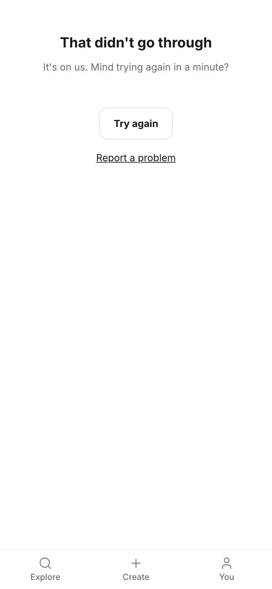
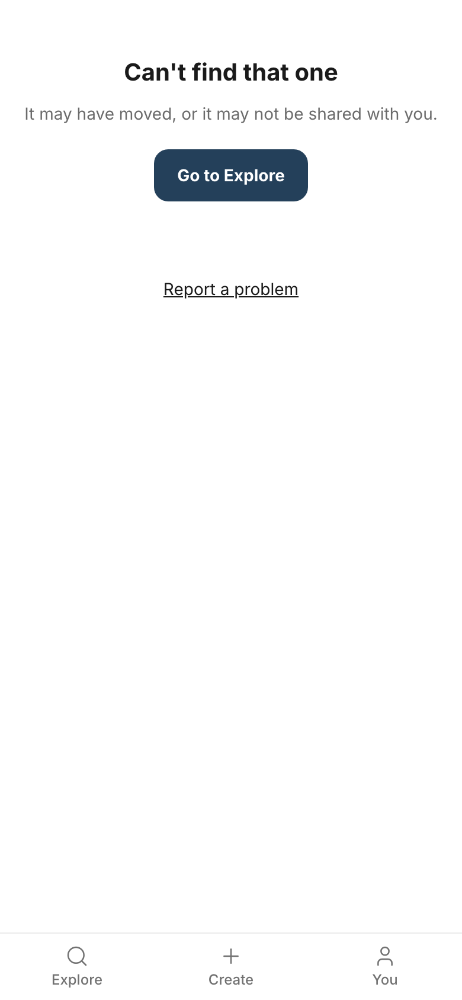
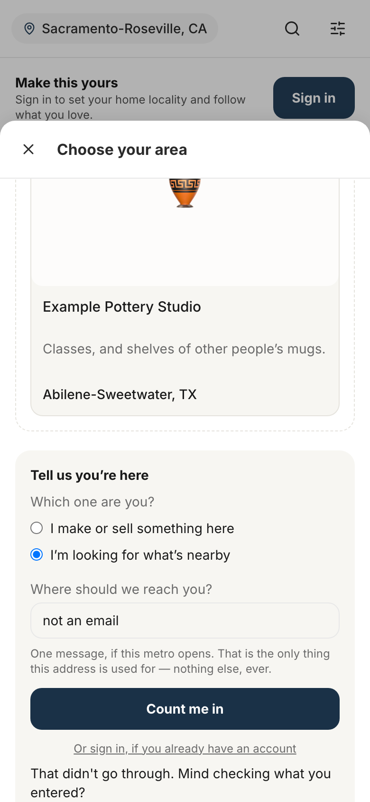
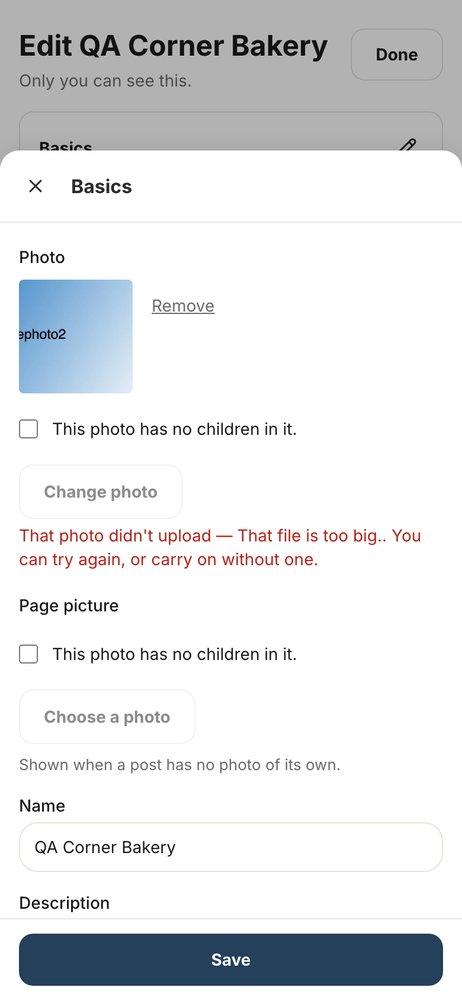
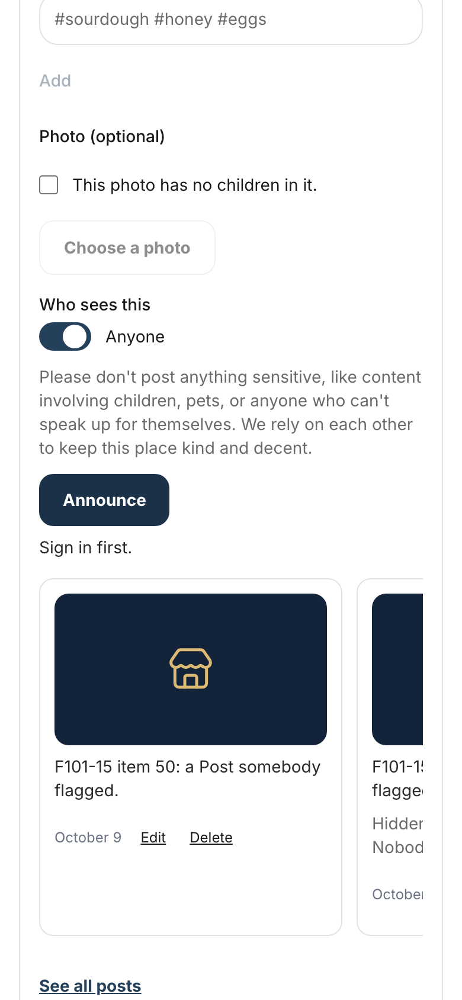
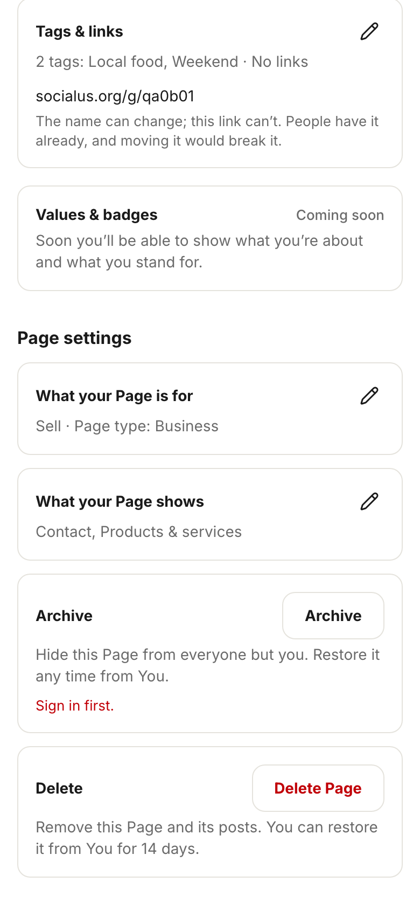

# Storyboard: errors, one shared voice (2026-10-11)

**Draft, not shipped.** Every line of copy here is a draft on a branch (branch `copy/errors-draft`, draft PR [socialus-web#688](https://github.com/donlafranchi/socialus-web/pull/688), not merged). Don reviews it in context first. Phone width (390px), a local database seeded with test members, so names like "QA Corner Bakery" are test data. The dev server's round "N" badge is hidden in these shots; it is not part of the app.

Errors stay plain by the copy rules: no jokes, no extra warmth. The house line is "That didn't go through. Mind trying again?"

## Things you will notice (need your call)

1. **The photo errors show a double period and an em dash** (shots 4 and 5): "That photo didn't upload — That file is too big.. You can try again, or carry on without one." The picker wraps the upload error in its own sentence, and that wrapper is §10's item (10.41, `PagePhotoPicker.tsx`), not §6's, so it is untouched here. §6 ends each upload error with a period as the report asks, which is what makes the double period until 10.41 lands. Options: A) land 10.41 with this ("That photo didn't upload. That file is too big. Mind trying again? You can also go on without one."); B) drop the trailing periods from §6 and keep the old wrapper for now; C) leave both as they are until the §10 storyboard.
2. **The not-found heading has no period.** The report writes "Can't find that one." but every heading on these screens goes without one ("That didn't go through", "Something went wrong" before it), so the shot shows "Can't find that one". Say the word if you want the period.
3. **"Sign in first." is only reachable when a session ends under you** (shots 6 and 7). The screens check sign-in before they show the controls, so the two lines were captured by signing the owner out underneath an open page, then saving a place and then archiving. That is what a member would see if their session expired in another tab.
4. **The shared "rejected input" line reaches members today through the metro waitlist** (shot 3): a bad email on Explore's "Not yet" metro panel used to show "Invalid input for metro.waitlist_join_anonymous". That shared line is now "That didn't go through. Mind checking what you entered?" everywhere an action rejects its input; the action name stays in the server log, not on screen. The waitlist's own email check ("That does not look like an email address.") sits behind it and is §3's.
5. **The whole-page error was forced** (shot 1) with a throwaway dev route that throws; nothing like it is committed. The last-resort global error screen (`global-error.tsx`, same two lines) cannot be shown by the dev server, which puts its own overlay there instead; the copy is applied, not pictured.
6. **Not captured:** the Create fallback (6.3, only when a just-made draft cannot be read back); "We couldn't find that place. Mind searching again?" (6.7, needs a place that vanished between picking and saving); the two "That didn't go through. Mind trying again?" fallbacks in the Location action (6.5, database failures only); "Add an address or a neighborhood so people can find it." (6.6, the composer will not send an unfinished place, so the server line is a guard with no UI path); and five of the seven photo lines (browser without canvas, encode timeout, encode failure, still too big after shrinking, storage unreachable). All are applied on the branch.

## 1. The whole-page error screen

Copy on this screen:

> That didn't go through
> It's on us. Mind trying again in a minute?
> Try again
> Report a problem

The same two lines are on the last-resort global error screen, which the dev server cannot show (see "Things you will notice", 5).

## 2. Not found: a Page address that goes nowhere

Copy on this screen:

> Can't find that one
> It may have moved, or it may not be shared with you.
> Go to Explore
> Report a problem

## 3. An action rejecting what was typed: the metro waitlist with a bad email, signed out

Copy on this screen:

> That didn't go through. Mind checking what you entered?

(The rest of the panel is §3's copy and is unchanged here.)

## 4. Choosing a file that is not a photo (a text file named .png), on the Page edit Basics sheet

Copy on this screen:

> That photo didn't upload — That file doesn't look like a photo.. You can try again, or carry on without one.

The §6 line is "That file doesn't look like a photo." The wrapper around it is §10's (see "Things you will notice", 1).

## 5. Choosing a file over the size limit (26 MB)

Copy on this screen:

> That photo didn't upload — That file is too big.. You can try again, or carry on without one.

The §6 line is "That file is too big."

## 6. Saving a place for a post after the session ended: the Location action answers

Copy on this screen:

> Sign in first.

## 7. Archiving a Page after the session ended: the Page lifecycle action answers

Copy on this screen:

> Archive
> Hide this Page from everyone but you. Restore it any time from You.
> Sign in first.

## Old and new, line by line

| Where | Now (live) | Draft |
|---|---|---|
| Whole-page error, heading (6.1) | Something went wrong | That didn't go through |
| Whole-page error, line (6.1) | It's on our side. Try again in a moment. | It's on us. Mind trying again in a minute? |
| Last-resort global error (6.1) | Something went wrong / It's on our side. Try again in a moment. | That didn't go through / It's on us. Mind trying again in a minute? |
| Not found, heading (6.2) | We couldn't find that | Can't find that one |
| Not found, line (6.2) | It may have moved, or it may not be shared with you. | (unchanged) |
| Create, draft cannot be read back (6.3) | That didn't go through. Try again? | That didn't go through. Mind trying again? |
| Any action rejecting its input (6.4) | Invalid input for ${name} | That didn't go through. Mind checking what you entered? |
| Location action, signed out (6.5) | You must be signed in. | Sign in first. |
| Location action, unexpected failure (6.5) | Something went wrong. Try again. | That didn't go through. Mind trying again? |
| Location action, save failed, two places (6.5) | Could not save the new Location. | That didn't go through. Mind trying again? |
| Location with no address (6.6) | A Location needs a real address or a neighbourhood — we never guess one. | Add an address or a neighborhood so people can find it. |
| Picked place cannot be found (6.7) | We could not find that place. Try searching for it again. | We couldn't find that place. Mind searching again? |
| Page lifecycle action, signed out (6.8) | You must be signed in. | Sign in first. |
| Photo: source file too big (6.9) | That file is too large to process. | That file is too big. |
| Photo: no canvas, two places (6.9) | This browser cannot process images. | This browser can't work with photos. |
| Photo: not an image (6.9) | That file is not a readable image. | That file doesn't look like a photo. |
| Photo: encode timed out (6.9) | Image encoding timed out. | That took too long. |
| Photo: encode failed (6.9) | Could not encode the image. | We couldn't prepare that photo. |
| Photo: still too big after resize (6.9) | That photo is too large even after resizing. | That photo is still too big after shrinking it. |
| Photo: upload failed (6.9) | it didn't reach our storage | It didn't reach us. |
