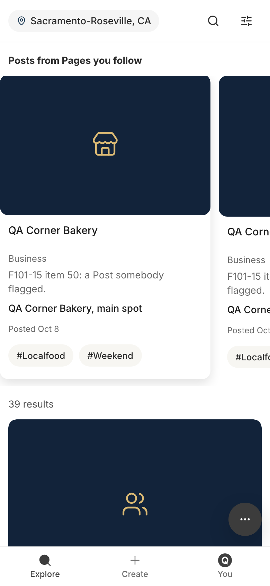
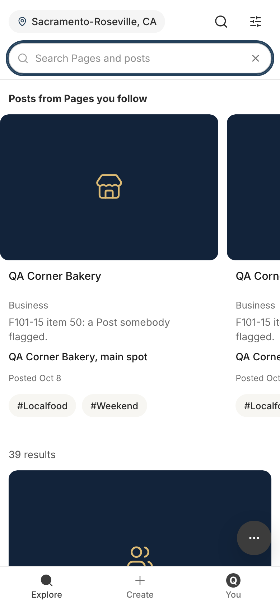
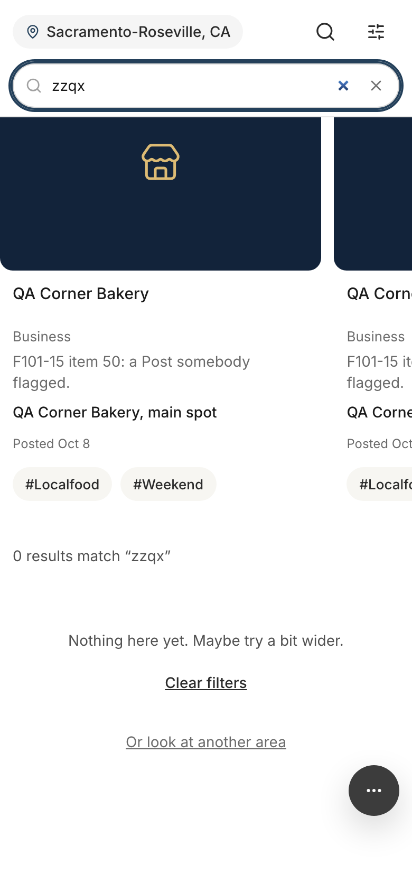
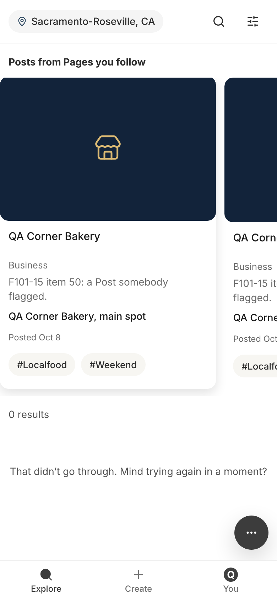
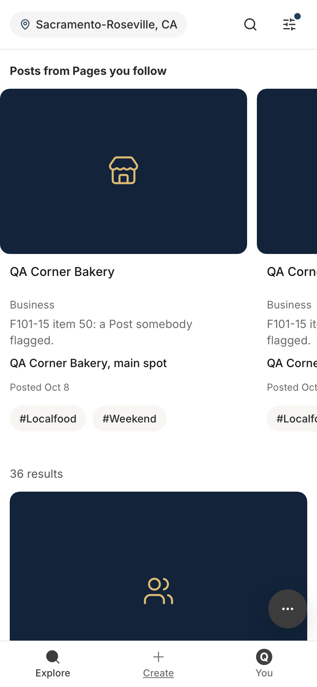
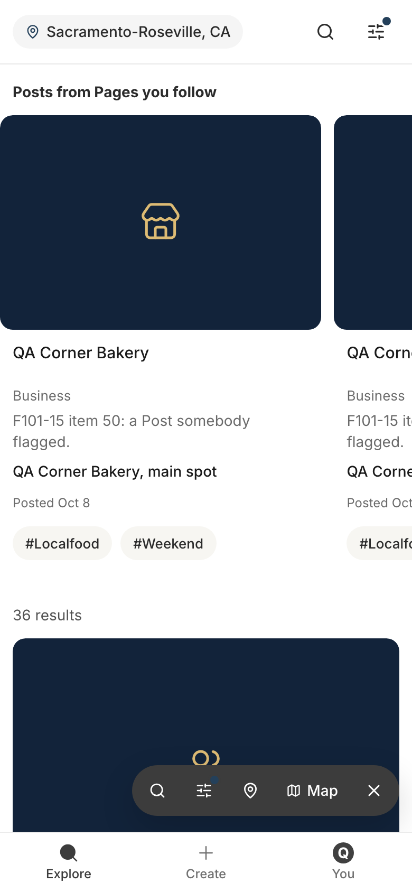
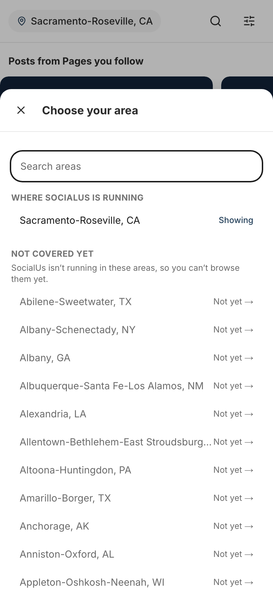
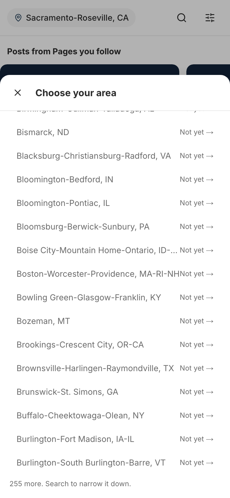
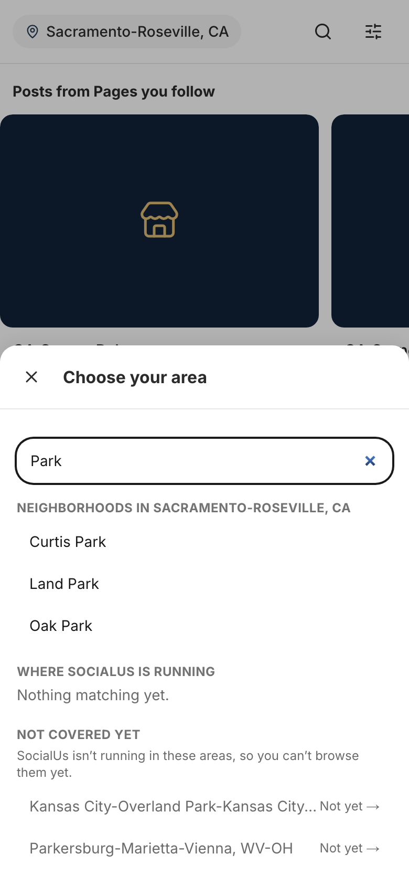
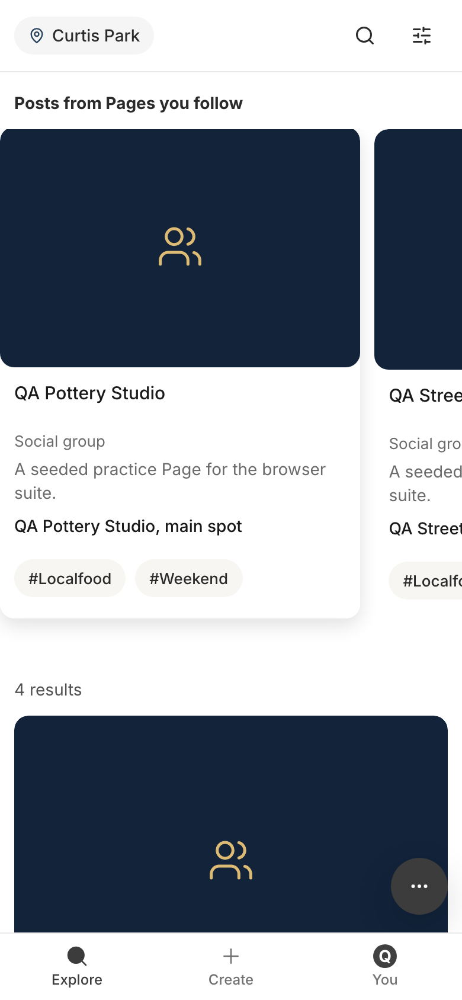

# Storyboard: Explore (2026-10-11)

**Draft, not shipped.** Every line of copy here is a draft on a branch (branch `copy/explore-draft`, draft PR [socialus-web#683](https://github.com/donlafranchi/socialus-web/pull/683), not merged). Don reviews it in context first. Phone width (390px), a local database seeded with test members, so names like "QA Corner Bakery" are test data. Signed in as the `member` test persona throughout; a signed-out visitor sees the same list, search box and dock (the map is members-only, and nothing in this section is on the map).

Four of the seven lines in this section are screen-reader labels (items 4.3 and 4.4). They are not visible on screen, so each shot that carries one shows the control and the copy block quotes the label as a screen reader would read it.

## Things you will notice (need your call)

1. **The map search box ("Search businesses...", item 4.7) is not changed.** It lives in `components/SearchBar.tsx`, which is only rendered by `components/Map.tsx`, and nothing in the app imports `Map.tsx`. It is not on any live route, so per the rules it was left alone and is listed under "Not captured". Options: A) delete `Map.tsx` and `SearchBar.tsx` in a chore, since the live map (`BrowseMap`) has no search box of its own (recommended); B) reword it anyway in case the component comes back; C) leave it.
2. **The screen-reader labels are invisible.** Shots 1, 2, 5, 6 and 10 show the control; the copy block carries the label text. "Area: Curtis Park, tap to change" says "tap" to a desktop screen-reader user too. Options: A) keep "tap to change" (the report's wording); B) "Area: Curtis Park. Change it"; C) "Change area: Curtis Park".
3. **The load-failure state was staged.** The list only fails when a change of area or metro does not come back, so the refetch was blocked and the metro re-chosen (shot 4). The line has no retry control under it; "trying again" means choosing the area again or reloading. That is existing behaviour, not a copy question, but the new line invites a tap that has nowhere to land. Options: A) leave it for the UI pass; B) note it as a follow-up to add a "Try again" link.
4. **The "more" line (item 4.5) and the neighborhoods heading (item 4.6) do not show together.** With the box empty, 255 metros are hidden behind "255 more. Search to narrow it down." (shot 8). Typing narrows the metro list as well, so the "more" line goes away as the neighborhoods appear (shot 9). Both states are captured; nothing to decide.
5. **The empty state offers "Clear filters" even when it was the search, not a filter, that found nothing** (shot 3). Existing behaviour; the new first line sits above it. The "Or look at another area" link sits below it.
6. **Not captured:** item 4.7 (see 1). No other item was skipped.

## 1. Explore as a signed-in member: the area pill at the top left (its screen-reader label is item 4.3)

Copy on this screen:

> Sacramento-Roseville, CA
> (screen reader, area pill: Area: Sacramento-Roseville, CA, tap to change)
> (screen reader, filter button, no filters on: Open filters)
> 39 results
> Browser tab: SocialUs

## 2. The search box open (its screen-reader label is item 4.4; the placeholder is unchanged)

Copy on this screen:

> (placeholder) Search Pages and posts
> (screen reader, search box: Search Pages and posts)

## 3. A search nothing matches: the empty state (item 4.1)

Copy on this screen:

> 0 results match "zzqx"
> Nothing here yet. Maybe try a bit wider.
> Clear filters
> Or look at another area

## 4. The list failed to load (item 4.2). Staged: the refetch was blocked, then the area re-chosen

Copy on this screen:

> 0 results
> That didn't go through. Mind trying again in a moment?

## 5. A filter on (#localfood): the dot on the filter button; its screen-reader label is item 4.3

Copy on this screen:

> (screen reader, filter button: Open filters, filters on)
> 36 results

## 6. The bottom dock open with a filter on: the dock filter button (its screen-reader label is item 4.3)

Copy on this screen:

> (screen reader, dock buttons: Search / Filter, filters on / Change area)
> Map

## 7. The "Choose your area" sheet as it opens

Copy on this screen:

> Choose your area
> (placeholder) Search areas
> Where SocialUs is running
> Sacramento-Roseville, CA  Showing
> Not covered yet
> SocialUs isn't running in these areas, so you can't browse them yet.

## 8. The same sheet scrolled to the bottom of the "Not covered yet" list: the "more" line (item 4.5)

Copy on this screen:

> 255 more. Search to narrow it down.

## 9. Typing "Park" in the area sheet: the neighborhoods heading (item 4.6)

Copy on this screen:

> Neighborhoods in Sacramento-Roseville, CA
> Curtis Park
> Land Park
> Oak Park
> Where SocialUs is running
> Nothing matching yet.
> Not covered yet
> SocialUs isn't running in these areas, so you can't browse them yet.

## 10. A neighborhood chosen: the pill names it (its screen-reader label is item 4.3)

Copy on this screen:

> Curtis Park
> (screen reader, area pill: Area: Curtis Park, tap to change)
> 4 results

## Old and new, line by line

| Where | Now (live) | Draft |
|---|---|---|
| Explore, no results (4.1) | Nothing here yet — try another filter | Nothing here yet. Maybe try a bit wider. |
| Explore, list failed to load (4.2) | We couldn't load {metro} just now. Try again in a moment. | That didn't go through. Mind trying again in a moment? |
| Dock filter button, screen reader (4.3) | Filter — filters applied | Filter, filters on |
| Search-row filter button, screen reader (4.3) | Open filters — filters applied | Open filters, filters on |
| Area pill, screen reader (4.3) | Area: {name} — change it | Area: {name}, tap to change |
| Search box, screen reader (4.4) | Search Browse | Search Pages and posts |
| Area sheet, long list (4.5) | {n} more — search to narrow. | {n} more. Search to narrow it down. |
| Area sheet, neighborhoods heading (4.6) | Neighbourhoods in {metro} | Neighborhoods in {metro} |
| Map search box (4.7), not on any live route | Search businesses... | unchanged (see "Things you will notice" 1) |
