# Storyboard: the front door, landing and About (2026-10-11)

**Draft, not shipped.** Every line of copy here is a draft on a branch (branch `copy/front-door-draft`, draft PR [socialus-web#681](https://github.com/donlafranchi/socialus-web/pull/681), not merged). Don reviews it in context first. It applies section 1 of the copy report (`planning/research/copy-voice-pass-2026-10-10.md`, items 1.1 to 1.26). Phone width (390px), a local database seeded with test members, so names like "QA Corner Bakery" are test data. Browser-tab titles and link previews cannot be seen in a screenshot, so they are written under the shot as "Browser tab:", "Search description:" and "Link preview …:". The `/landing` pages are a noindex preview, not linked from the app.

## Things you will notice (need your call)

1. **The name shows twice wherever the title and the description sit together.** The site title is now "SocialUs: the people's platform" and the description is your "SocialUs, a local discovery platform." (shots 14 to 22). On the share image (shot 25) the big "SocialUs" sits above "SocialUs: the people's platform." Options: A) leave it, the name is the point; B) share image gold line reads "the people's platform." only; C) description drops the name ("A local discovery platform.").
2. **The preview's About tab reads "About SocialUs | SocialUs"** (shot 8), since 1.19 renames the page "About SocialUs" and every title carries the suffix. Options: A) leave it; B) tab title "About | SocialUs" while the heading stays "About SocialUs".
3. **"Members first, always." is placed where the report's voice-guide table proposes it**, not where the numbered items say: the end of the landing members block (shot 4, in place of "We're in this together"), under the paragraph on the signup card and onboarding (shots 23, 24) and as the closing line of the live About (shot 14). Easy to drop any of them. The footer follows item 1.5 ("© SocialUs, the people's platform", shot 26); the table proposes "© SocialUs · Members first, always." instead, and the two cannot both fit. Your call: A) tagline in the footer (as shot); B) "Members first, always." in the footer.
4. **Your data sentence carries a second "never"** (shot 9: "never to enrich shareholders or investors"), beside "never extractive". It is kept verbatim per DECISIONS 2026-10-11. The landing-copy test now allows exactly those two.
5. **For socialus-legal** (repeated from the report): 1.20 says opting out is easy, a claim about what a member can do today; 1.23 keeps forward-looking structural commitments (public benefit corporation, member body, a structure that keeps the mission in place); 1.24 states who we currently don't take money from, next to the ruling that members are the investors. Counsel should look before any of it is public.
6. **The signup card is on the password route** (shot 23, `/auth/password`, unlinked; the public flow is magic-link). That is the only place the "Creating an account" card with these three lines appears. The onboarding shot (24) also shows "your neighbors" and "never shown", which are section 3 and untouched here.
7. **Two titles outside the report's list lost their em dash too**, so one pattern holds: `/you/following` ("Following | SocialUs") and a place inside a place ("Place | Root"). The `/landing` preview's own tab stays the bare "SocialUs" (it sets its own title; the report does not mention it).
8. **Not captured:** a real item, venue or member title (1.15, 1.17): the test data has none at those addresses, so the Not-found forms (shots 19 to 21) stand in; the pattern is the same string. A real share of a Page with no photo: the test Page has one, so the share image is shown on its own (shot 25). The sign-in button on the waitlist's "Your area is open" result (unchanged copy).
9. **Test data added:** two throwaway accounts named `storyboard-front-door-<number>@example.test` in the local stack, made to reach the signup card. Nothing seeded was changed.

## 1. The front door preview (/landing) as it opens on a phone: the headline is the tagline

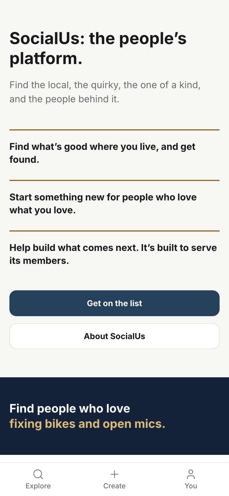

Copy on this screen:

> SocialUs: the people’s platform.
> Find the local, the quirky, the one of a kind, and the people behind it.

## 2. The three verb lines and the two buttons

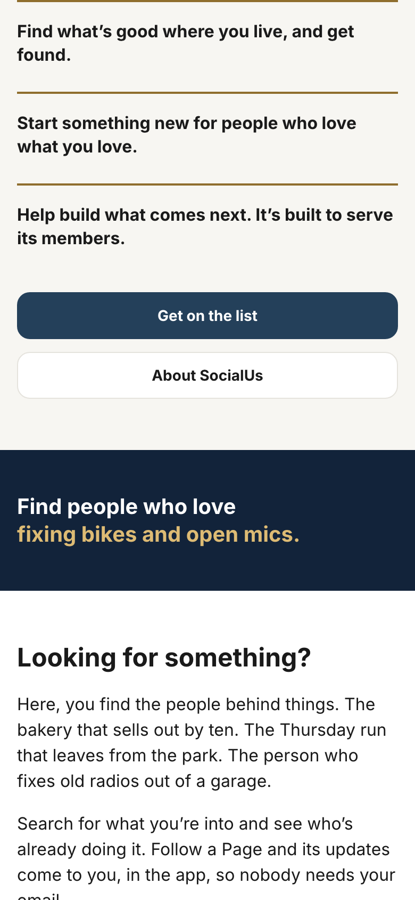

Copy on this screen:

> Find what’s good where you live, and get found.
> Start something new for people who love what you love.
> Help build what comes next. It’s built to serve its members.
> Get on the list
> About SocialUs

## 3. "Want to be found?": the placement line

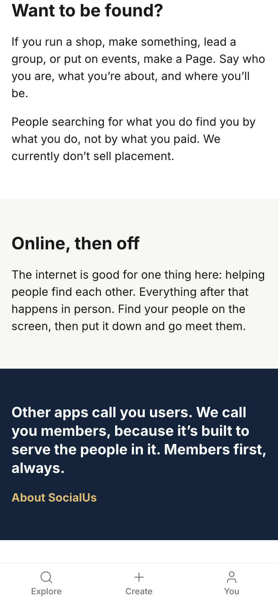

Copy on this screen:

> Want to be found?
> If you run a shop, make something, lead a group, or put on events, make a Page. Say who you are, what you’re about, and where you’ll be.
> People searching for what you do find you by what you do, not by what you paid. We currently don’t sell placement.

## 4. The members block, with its link to the About page

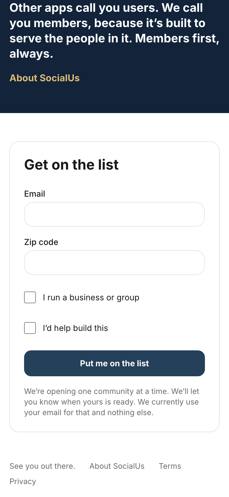

Copy on this screen:

> Other apps call you users. We call you members, because it’s built to serve the people in it. Members first, always.
> About SocialUs

## 5. The waitlist form, with the note under the button

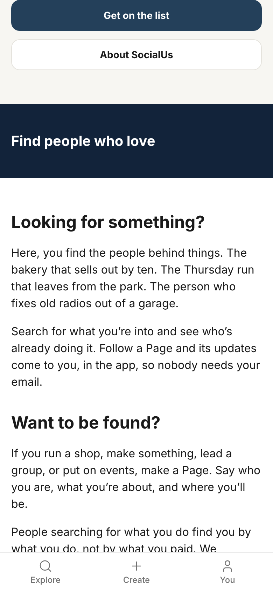

Copy on this screen:

> Get on the list
> Email
> Zip code
> I run a business or group
> I’d help build this
> Put me on the list
> We’re opening one community at a time. We’ll let you know when yours is ready. We currently use your email for that and nothing else.

## 6. The waitlist form sent empty: the email error

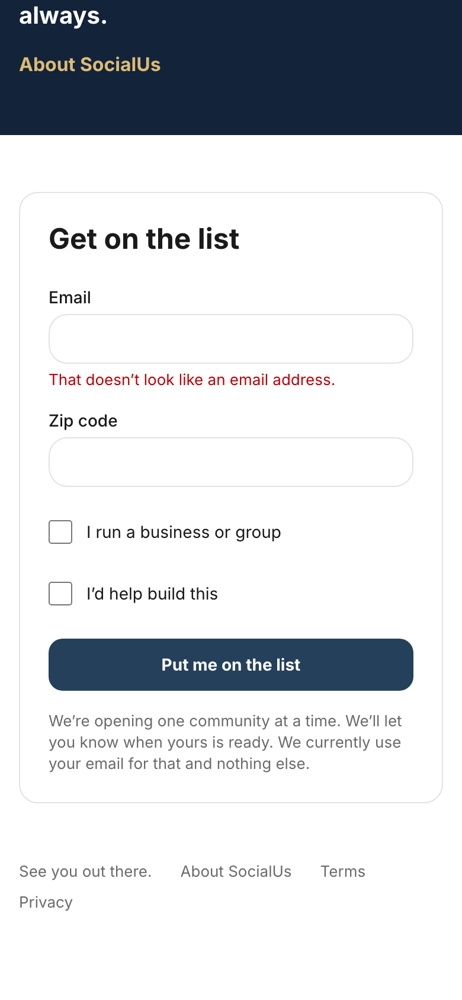

Copy on this screen:

> That doesn’t look like an email address.

## 7. The bottom of the preview: the sign-off and the About link

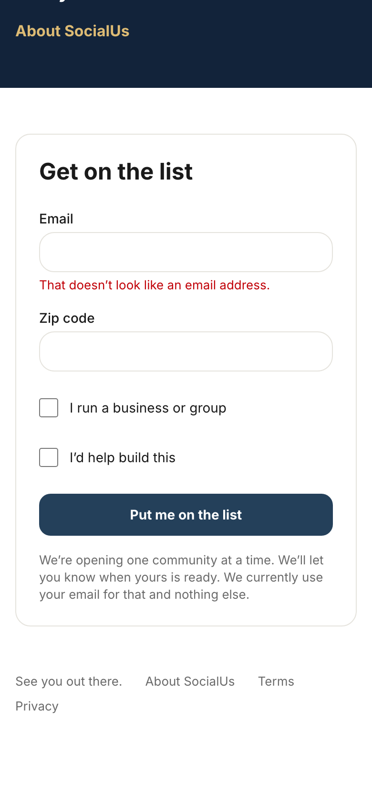

Copy on this screen:

> See you out there.
> About SocialUs
> Terms
> Privacy

## 8. The preview's About (/landing/about): its title and the start of "What this is for"

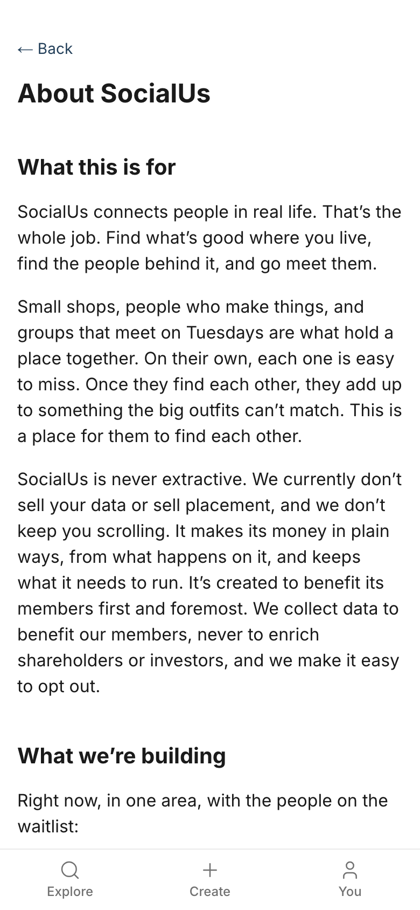

Copy on this screen:

> About SocialUs
> What this is for
> SocialUs connects people in real life. That’s the whole job. Find what’s good where you live, find the people behind it, and go meet them.
> Small shops, people who make things, and groups that meet on Tuesdays are what hold a place together. On their own, each one is easy to miss. Once they find each other, they add up to something the big outfits can’t match. This is a place for them to find each other.
> SocialUs is never extractive. We currently don’t sell your data or sell placement, and we don’t keep you scrolling. It makes its money in plain ways, from what happens on it, and keeps what it needs to run. It’s created to benefit its members first and foremost. We collect data to benefit our members, never to enrich shareholders or investors, and we make it easy to opt out.
> Browser tab: About SocialUs | SocialUs
> Search description: SocialUs, a local discovery platform.
> Link preview title: SocialUs: the people's platform
> Link preview description: SocialUs, a local discovery platform.

## 9. "What this is for", third paragraph: never extractive, "we currently don't", and Don's data line

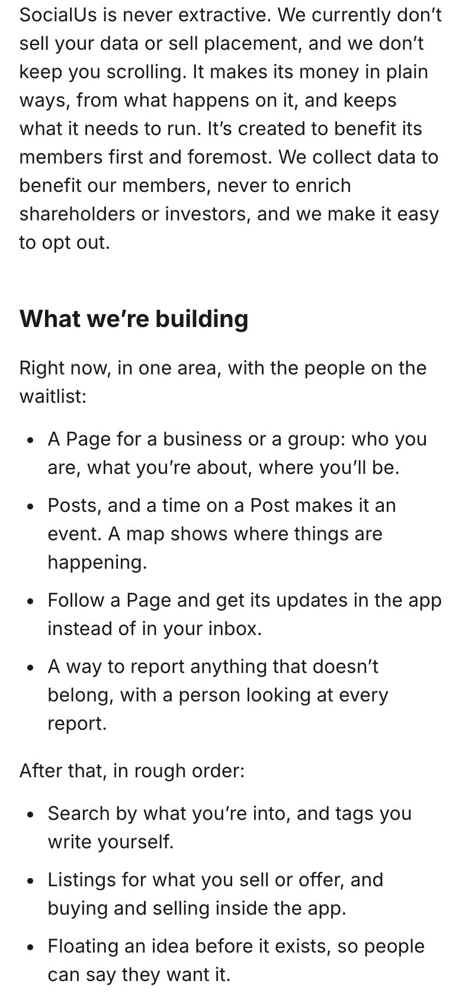

Copy on this screen:

> SocialUs is never extractive. We currently don’t sell your data or sell placement, and we don’t keep you scrolling. It makes its money in plain ways, from what happens on it, and keeps what it needs to run. It’s created to benefit its members first and foremost. We collect data to benefit our members, never to enrich shareholders or investors, and we make it easy to opt out.

## 10. "What we're building", the later list and its closing line

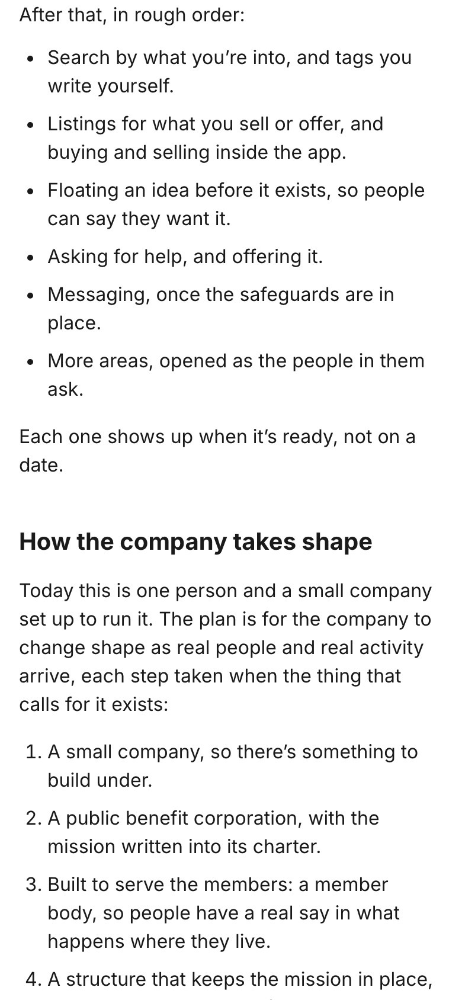

Copy on this screen:

> Each one shows up when it’s ready, not on a date.

## 11. "How the company takes shape": the four steps

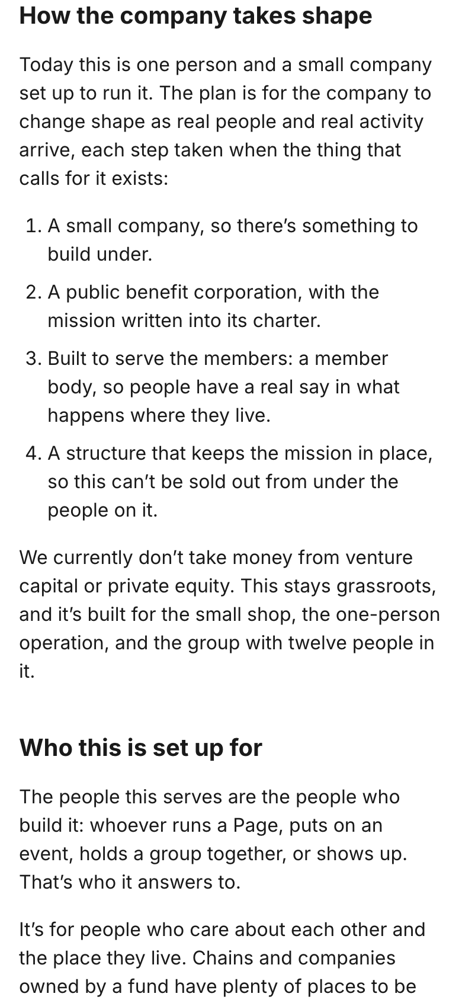

Copy on this screen:

> How the company takes shape
> A small company, so there’s something to build under.
> A public benefit corporation, with the mission written into its charter.
> Built to serve the members: a member body, so people have a real say in what happens where they live.
> A structure that keeps the mission in place, so this can’t be sold out from under the people on it.

## 12. The investors paragraph under the steps

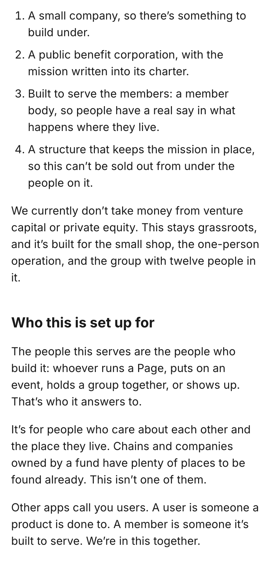

Copy on this screen:

> We currently don’t take money from venture capital or private equity. This stays grassroots, and it’s built for the small shop, the one-person operation, and the group with twelve people in it.

## 13. "Who this is set up for": the members paragraph at the end

Copy on this screen:

> Who this is set up for
> The people this serves are the people who build it: whoever runs a Page, puts on an event, holds a group together, or shows up. That’s who it answers to.
> It’s for people who care about each other and the place they live. Chains and companies owned by a fund have plenty of places to be found already. This isn’t one of them.
> Other apps call you users. A user is someone a product is done to. A member is someone it’s built to serve. We’re in this together.

## 14. The live About page (/about): tagline line, Don's paragraph unchanged, closing line

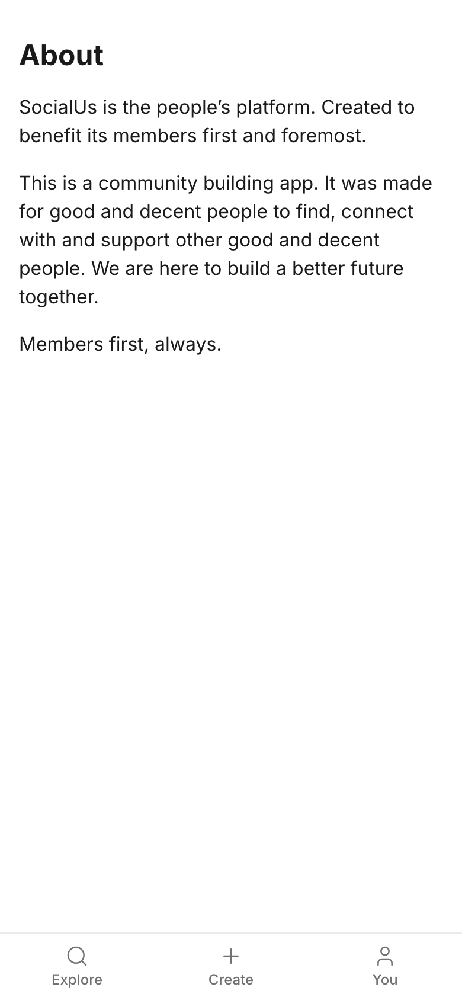

Copy on this screen:

> About
> SocialUs is the people’s platform. Created to benefit its members first and foremost.
> This is a community building app. It was made for good and decent people to find, connect with and support other good and decent people. We are here to build a better future together.
> Members first, always.
> Browser tab: About | SocialUs
> Search description: SocialUs, a local discovery platform.
> Link preview title: SocialUs: the people's platform
> Link preview description: SocialUs, a local discovery platform.

## 15. Terms (/terms): only the browser-tab title changes (read it below the shot)

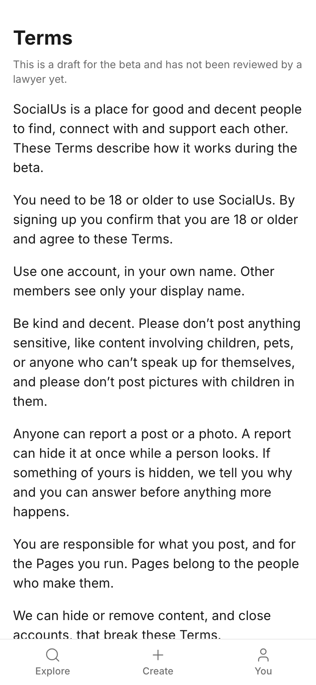

Copy on this screen:

> Terms
> Browser tab: Terms | SocialUs
> Search description: SocialUs, a local discovery platform.
> Link preview title: SocialUs: the people's platform
> Link preview description: SocialUs, a local discovery platform.

## 16. Privacy (/privacy): only the browser-tab title changes (read it below the shot)

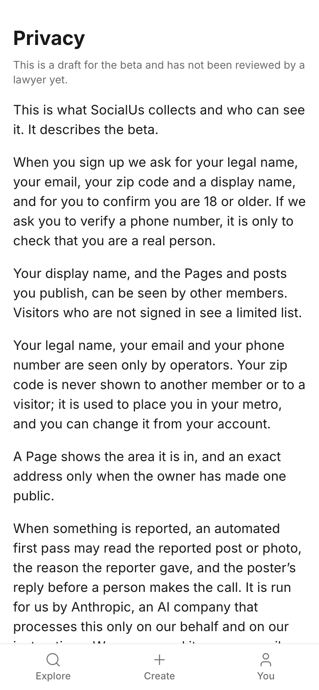

Copy on this screen:

> Privacy
> Browser tab: Privacy | SocialUs
> Search description: SocialUs, a local discovery platform.
> Link preview title: SocialUs: the people's platform
> Link preview description: SocialUs, a local discovery platform.

## 17. The rules (/rules): only the browser-tab title changes (read it below the shot)

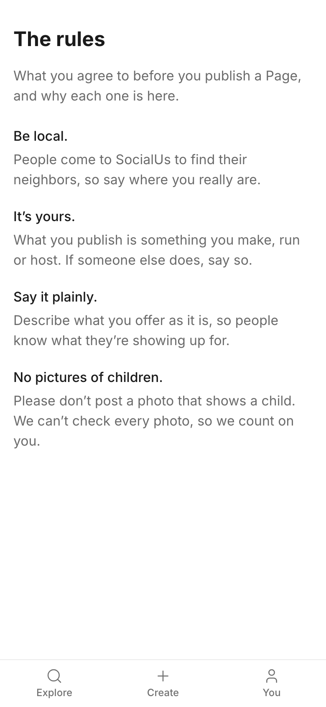

Copy on this screen:

> The rules
> Browser tab: The rules | SocialUs
> Search description: SocialUs, a local discovery platform.
> Link preview title: SocialUs: the people's platform
> Link preview description: SocialUs, a local discovery platform.

## 18. A Page (QA Corner Bakery, test data): the tab title and link preview change, nothing on screen does

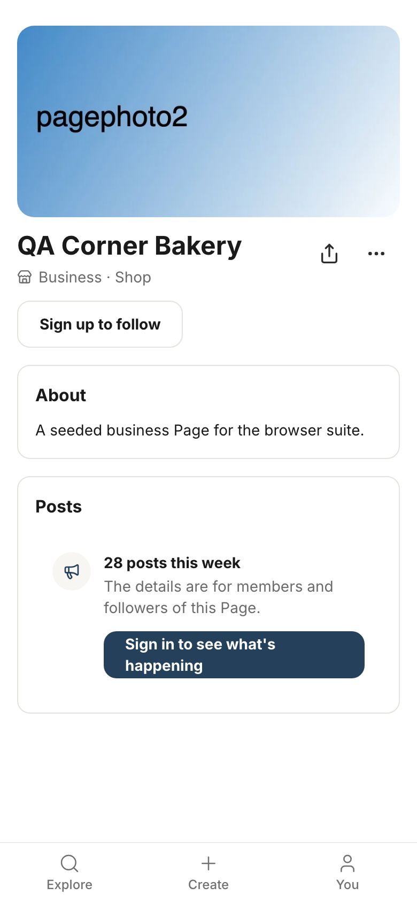

Copy on this screen:

> Browser tab: QA Corner Bakery | SocialUs
> Search description: A seeded business Page for the browser suite.
> Link preview title: QA Corner Bakery
> Link preview description: A seeded business Page for the browser suite.
> Link preview image: (the Page's own photo)

## 19. Not found, a Page address that resolves to nothing: the tab title

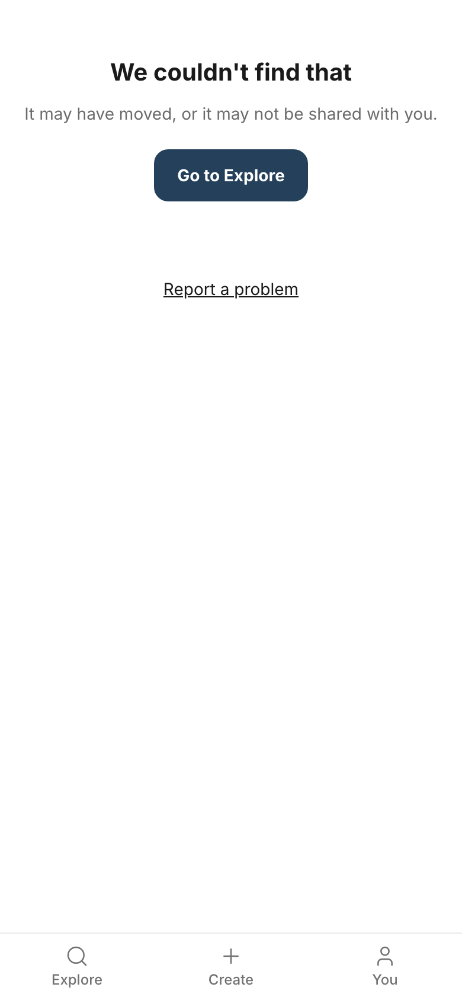

Copy on this screen:

> We couldn't find that
> It may have moved, or it may not be shared with you.
> Go to Explore
> Report a problem
> Browser tab: Not found | SocialUs
> Search description: SocialUs, a local discovery platform.
> Link preview title: SocialUs: the people's platform
> Link preview description: SocialUs, a local discovery platform.

## 20. Not found, a member address (/m/…): the tab title

Copy on this screen:

> We couldn't find that
> It may have moved, or it may not be shared with you.
> Go to Explore
> Report a problem
> Browser tab: Not found | SocialUs
> Search description: SocialUs, a local discovery platform.
> Link preview title: SocialUs: the people's platform
> Link preview description: SocialUs, a local discovery platform.

## 21. Not found, a place address (/p/…): the tab title

Copy on this screen:

> We couldn't find that
> It may have moved, or it may not be shared with you.
> Go to Explore
> Report a problem
> Browser tab: Place not found | SocialUs
> Search description: SocialUs, a local discovery platform.
> Link preview title: SocialUs: the people's platform
> Link preview description: SocialUs, a local discovery platform.

## 22. Explore, signed out: carries the site title and description (search result and shared link)

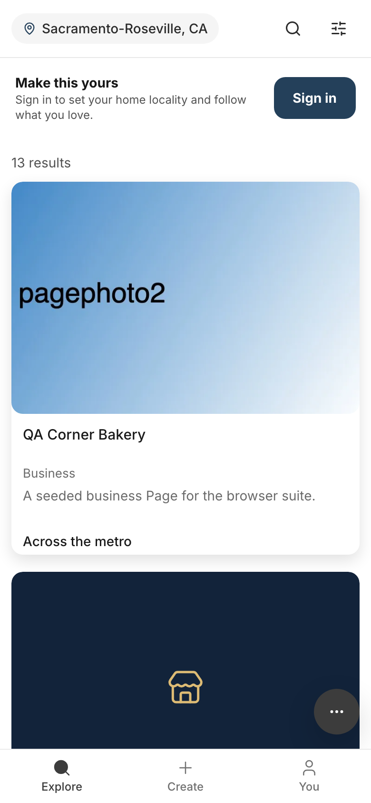

Copy on this screen:

> Browser tab: SocialUs: the people's platform
> Search description: SocialUs, a local discovery platform.
> Link preview title: SocialUs: the people's platform
> Link preview description: SocialUs, a local discovery platform.

## 23. The signup card (new account, password route): tagline line above Don's paragraph, "Members first, always." under it

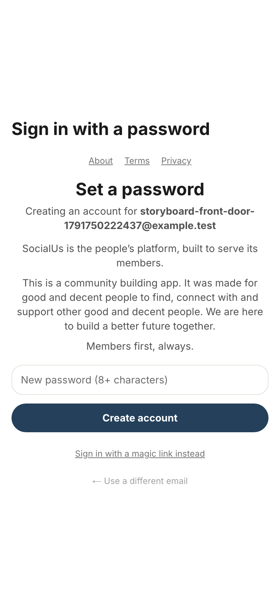

Copy on this screen:

> Set a password
> Creating an account for storyboard-front-door-1791750222437@example.test
> SocialUs is the people’s platform, built to serve its members.
> This is a community building app. It was made for good and decent people to find, connect with and support other good and decent people. We are here to build a better future together.
> Members first, always.

## 24. Onboarding, first screen: the same three lines under "Tell us who you are"

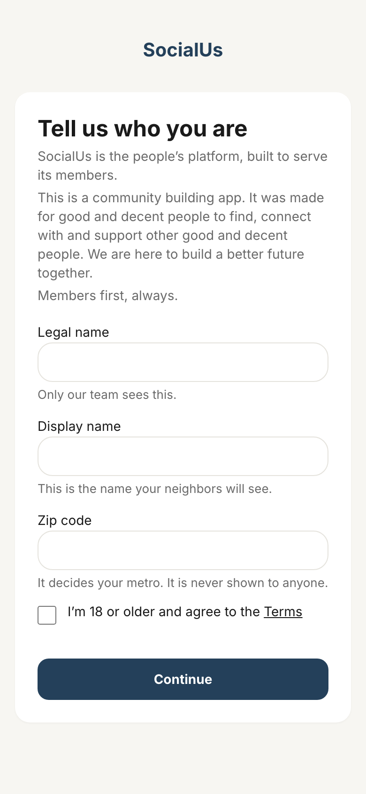

Copy on this screen:

> Tell us who you are
> SocialUs is the people’s platform, built to serve its members.
> This is a community building app. It was made for good and decent people to find, connect with and support other good and decent people. We are here to build a better future together.
> Members first, always.

## 25. The share image a Page without a photo gets (1200x630, not a phone screen)

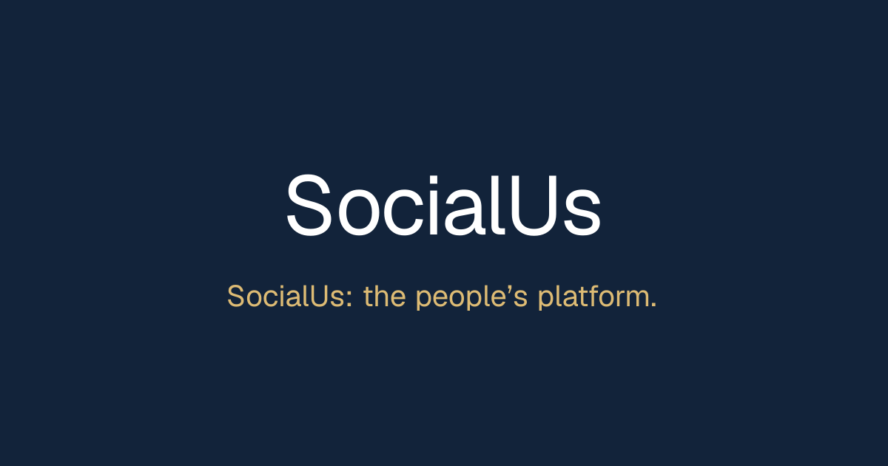

Copy on this screen:

> SocialUs
> SocialUs: the people’s platform.

## 26. The footer, desktop only (1280 wide; it does not show on a phone)

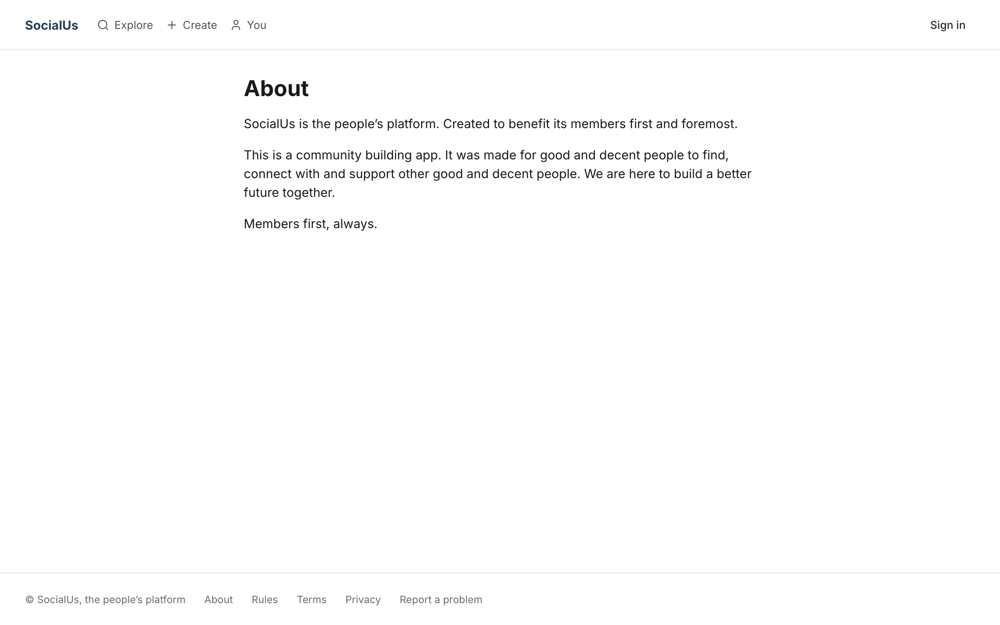

Copy on this screen:

> © SocialUs, the people’s platform
> About
> Rules
> Terms
> Privacy
> Report a problem

## Old and new, line by line

| # | Where | Now (live) | Draft |
|---|---|---|---|
| 1.1 | Site description (search result, shared link) | Find and support the people near you. Meet your neighbors, trade what you make, volunteer where it's needed, and share an idea before you build it. | SocialUs, a local discovery platform. |
| 1.2 | Site title (browser tab, search) | SocialUs | SocialUs: the people's platform |
| 1.3 | Share image, gold line | Find and support the people near you. | SocialUs: the people's platform. |
| 1.4 | Page titles: About, Terms, Privacy, The rules, every Page, every Not found | Terms — SocialUs | Terms \| SocialUs |
| 1.5 | Desktop footer | © SocialUs | © SocialUs, the people's platform |
| 1.6 | /landing headline | A local discovery platform, for the people. | SocialUs: the people's platform. |
| 1.7 | /landing first verb | Find what's good near you, and get found. | Find what's good where you live, and get found. |
| 1.8 | /landing third verb | Shape your community, and help build what comes next. | Help build what comes next. It's built to serve its members. |
| 1.9 | /landing second button, and the members-block and foot links | How we're different | About SocialUs |
| 1.10 | /landing "Want to be found?" | …not by what you paid. Nobody buys their way to the top here. | …not by what you paid. We currently don't sell placement. |
| 1.11 | /landing members line | Other apps call you users. We call you members. We're in this together, and this is for us. | Other apps call you users. We call you members, because it's built to serve the people in it. Members first, always. |
| 1.12 | /landing waitlist note | We're opening one community at a time. You'll hear from us when yours is ready, and that's all we use your email for. | We're opening one community at a time. We'll let you know when yours is ready. We currently use your email for that and nothing else. |
| 1.13 | /landing waitlist email error | That does not look like an email address. | That doesn't look like an email address. |
| 1.14 | Signup card and onboarding, above Don's paragraph (unchanged) | | SocialUs is the people's platform, built to serve its members. |
| 1.14 | Signup card and onboarding, under Don's paragraph (voice-guide table) | | Members first, always. |
| 1.15 | Member event, product, service and Not-found titles (/m/…) | Not found — SocialUs / {title} — SocialUs | Not found \| SocialUs / {title} \| SocialUs |
| 1.16 | A Page that is not found | Not found — SocialUs | Not found \| SocialUs |
| 1.17 | Items, venues and places (/p/…) | Not found — SocialUs / Place not found — SocialUs / {title} — SocialUs / {place} — {root} | Not found \| SocialUs / Place not found \| SocialUs / {title} \| SocialUs / {place} \| {root} |
| 1.18 | A shared Page's title | {Page name} — SocialUs | {Page name} \| SocialUs |
| 1.19 | /landing/about title | How we're different | About SocialUs |
| 1.20 | /landing/about "What this is for", third paragraph | SocialUs is never extractive. It doesn't sell your data. It doesn't sell placement. It doesn't keep you scrolling. It makes its money in plain ways, from what happens on it, and keeps what it needs to run. | SocialUs is never extractive. We currently don't sell your data or sell placement, and we don't keep you scrolling. It makes its money in plain ways, from what happens on it, and keeps what it needs to run. It's created to benefit its members first and foremost. We collect data to benefit our members, never to enrich shareholders or investors, and we make it easy to opt out. |
| 1.21 | /landing/about "What we're building" closing line | Each of these lands when it's ready, not on a date. | Each one shows up when it's ready, not on a date. |
| 1.22 | /landing/about section title | How the company grows up | How the company takes shape |
| 1.23 | /landing/about company steps 3 and 4 | A member body, so people have a real say in what happens where they live. / A structure that locks the mission in, so this can't be sold out from under the people on it. | Built to serve the members: a member body, so people have a real say in what happens where they live. / A structure that keeps the mission in place, so this can't be sold out from under the people on it. |
| 1.24 | /landing/about investors paragraph | We don't take money from traditional investors. No venture capital, no private equity. This stays grassroots… | We currently don't take money from venture capital or private equity. This stays grassroots… |
| 1.25 | /landing/about "Who this is set up for", last paragraph | …A member is someone it belongs with. We're in this together, and this is for us. | …A member is someone it's built to serve. We're in this together. |
| 1.26 | /about, above Don's paragraph (unchanged) | | SocialUs is the people's platform. Created to benefit its members first and foremost. |
| 1.26 | /about, closing line (voice-guide table) | | Members first, always. |
| (not in the report) | /you/following title; a place inside a place | Following — SocialUs; {place} — {root} | Following \| SocialUs; {place} \| {root} |
