# Storyboard: onboarding and the metro waitlist (2026-10-11)

**Draft, not shipped.** Every line of copy here is a draft on a branch (branch `copy/onboarding-waitlist-draft`, draft PR [socialus-web#684](https://github.com/donlafranchi/socialus-web/pull/684), not merged). Don reviews it in context first. Phone width (390px), a local database seeded with test members, so names like "Sam Storyboard" and "QA Corner Bakery" are test data. The small round "N" and the "Rendering…" pill in the corner are the dev server's badge, not part of the app. The phone step was captured with a local test number; no text was sent.

Copy report §3 (15 items) plus the one line §2 left here: the catch-all error on the sign-up form.

## Things you will notice (need your call)

1. **The live flow skips two of these screens.** After Continue on the sign-up form, the app goes straight to Explore (shot 6). The "You're in Sacramento" confirmation (shot 7) and the "Where are you, and why?" waitlist step (shots 8 and 9) never show, because the page sends people on the moment the profile is saved. Shots 7 to 9 come from a capture harness that renders the same screens with the same copy, so you can still read them. This is a bug, not a copy matter: today a member outside Sacramento lands in Sacramento's Explore and is never asked where they are. Options: A) fix the hand-off so the two screens show (recommended; the copy is ready for it); B) retire the two screens and their copy; C) leave it.
2. **A bad email shows developer text** (shot 16): "Invalid input for metro.waitlist_join_anonymous" instead of the plain "That doesn't look like an email address." The plain line is in the draft (item 3.12); a wrapper on the server hides it. A) have the panel show the plain line (recommended); B) leave it. Not a copy matter.
3. **Leaving a good address signed out ends in an error today** (shot 17). The address is saved and counted, but the count read fails on the server, the popup never opens, and the person sees a technical line. So the signed-out popup and the signed-out "Done. You're counted in…" line could not be captured; the signed-in ones (shots 9, 12 and 13) carry the same copy. A bug for the build queue, not a copy matter.
4. **"A person from our team"** in the enough-people popup (shot 12). The report says "A person looks over each area before it opens"; the copy rules say "a person from our team" for whoever looks at things, so the draft says that.
5. **The popup names the metro**, as the report asked: "We need 299 more people in Portland-Vancouver-Salem, OR-WA before it's ready to open. We'll let you know." With a long metro name the sentence runs long (shot 9), and the popup's title already shows the name. A) keep as is; B) drop the name from the sentence: "We need 299 more people before it's ready to open. We'll let you know." (my lean).
6. **"We'll let you know."** is a promise to tell people. It passes the popup's rule (no date, no promise to open), but something has to send that message when a metro opens, for members as well as for the addresses left signed out.
7. **The interests picker (item 3.15, "Crafts & makers" to "Crafts") has no live screen.** The list of labels exists in code and nothing renders it. Changed in the draft, not captured.
8. **Not captured:** the fallback error on the waitlist step and on the panel (items 3.5 and 3.8, "That didn't go through. Mind trying again?"). It only shows when a failure carries no message of its own, and every failure we could trigger carries one (shots 16 and 17 show the slot it would use). Also the one-person wording of the popup ("We need one more person…"), which needs 299 people in a metro.
9. **For socialus-legal, as the report notes:** the zip line (shot 4), the phone line (shot 1) and the email note (shot 15) each restate a privacy promise in the "we currently don't" form.

## 1. The phone check, first screen of onboarding

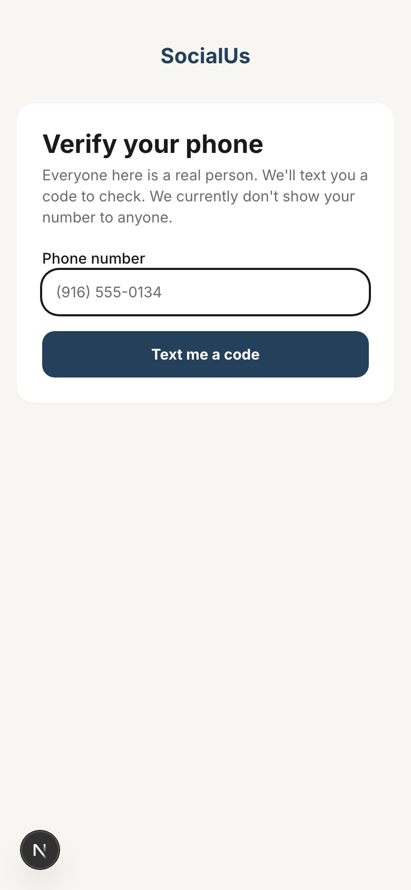

Copy on this screen:

> Verify your phone
> Everyone here is a real person. We'll text you a code to check. We currently don't show your number to anyone.
> Phone number
> Text me a code

## 2. The code screen (unchanged copy, shown for context)

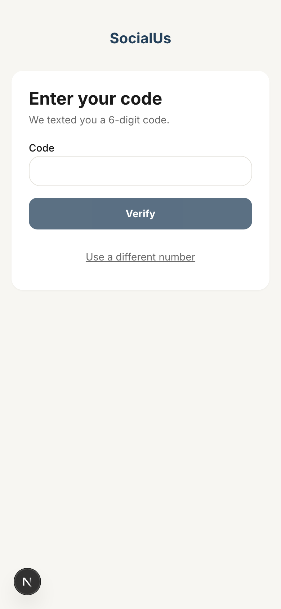

Copy on this screen:

> Enter your code
> We texted you a 6-digit code.
> Code
> Verify
> Use a different number

## 3. Tell us who you are: the one-screen sign-up form as it opens

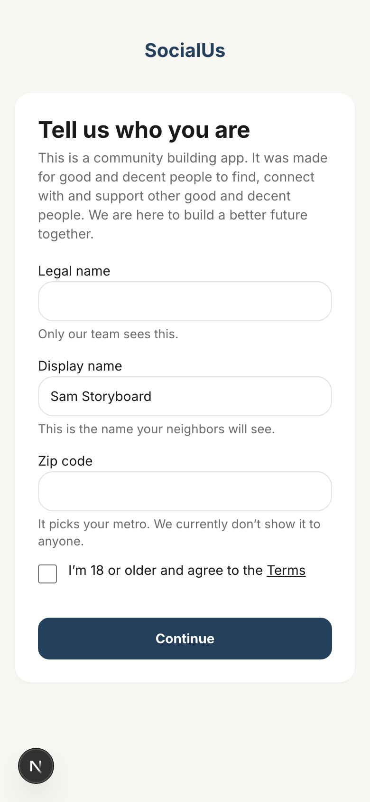

Copy on this screen:

> Tell us who you are
> This is a community building app. It was made for good and decent people to find, connect with and support other good and decent people. We are here to build a better future together.
> Legal name
> Only our team sees this.
> Display name
> This is the name your neighbors will see.
> Zip code
> It picks your metro. We currently don’t show it to anyone.
> I’m 18 or older and agree to the Terms
> Continue

## 4. Filled in, scrolled to the zip box and its help line

Copy on this screen:

> Zip code
> It picks your metro. We currently don’t show it to anyone.

## 5. Continue without ticking the 18+ box: the error

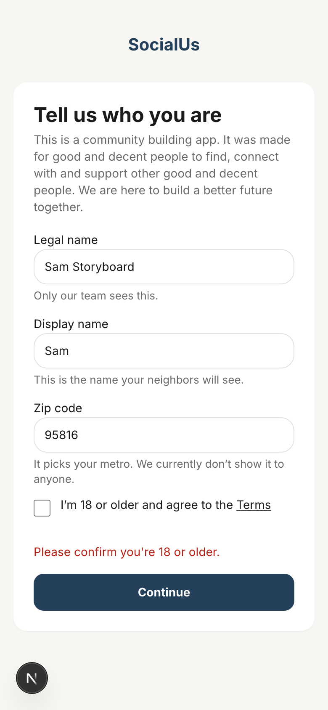

Copy on this screen:

> Please confirm you're 18 or older.

## 6. What the live flow actually shows after Continue: Explore, not the confirmation

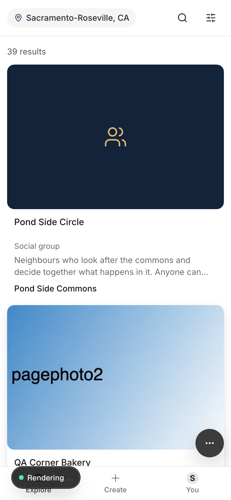

Copy on this screen:

> (none of this section's copy; see item 1 above)

## 7. A Sacramento zip: the confirmation (capture harness, see item 1)

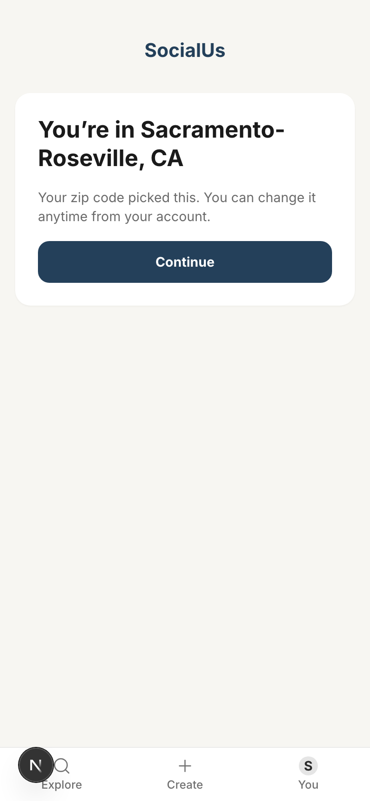

Copy on this screen:

> You’re in Sacramento-Roseville, CA
> Your zip code picked this. You can change it anytime from your account.
> Continue

## 8. A Portland zip: the "Where are you, and why?" step (capture harness, see item 1)

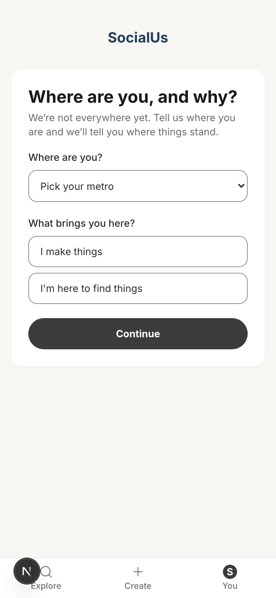

Copy on this screen:

> Where are you, and why?
> We’re not everywhere yet. Tell us where you are and we’ll tell you where things stand.
> Where are you?
> Pick your metro
> What brings you here?
> I make things
> I'm here to find things
> Continue

## 9. After Continue: the popup, with the count and the "we need more people" line

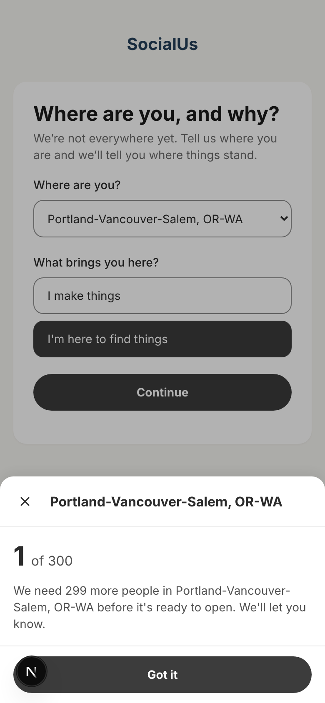

Copy on this screen:

> Portland-Vancouver-Salem, OR-WA
> 1 of 300
> We need 299 more people in Portland-Vancouver-Salem, OR-WA before it's ready to open. We'll let you know.
> Got it

## 10. Explore, signed in: a metro that is not open yet (the panel as it opens)

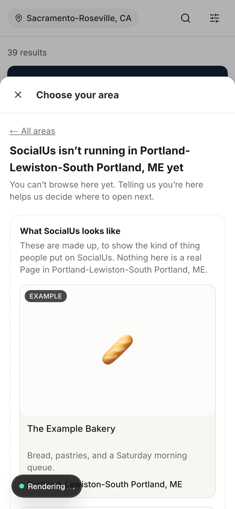

Copy on this screen:

> ← All areas
> SocialUs isn’t running in Portland-Lewiston-South Portland, ME yet
> You can’t browse here yet. Telling us you’re here helps us decide where to open next.
> What SocialUs looks like
> These are made up, to show the kind of thing people put on SocialUs. Nothing here is a real Page in Portland-Lewiston-South Portland, ME.

## 11. Same panel, scrolled to the role choices and the button

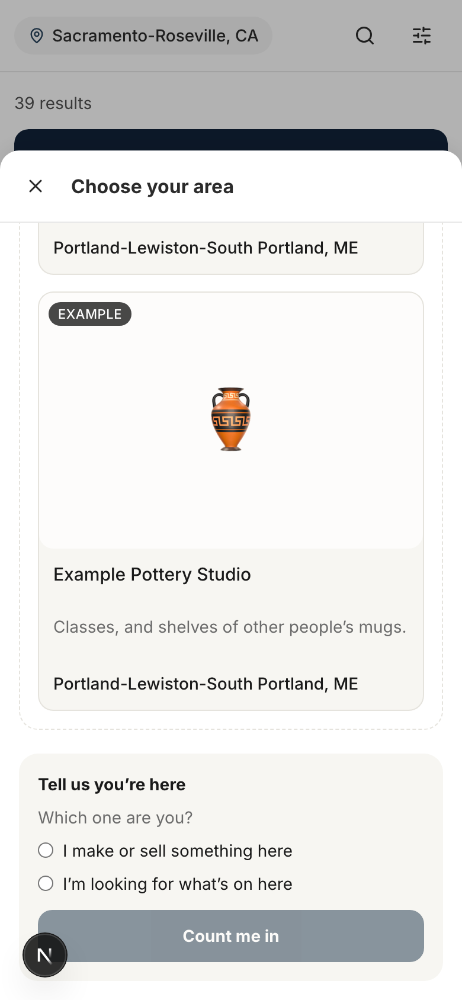

Copy on this screen:

> Tell us you’re here
> Which one are you?
> I make or sell something here
> I’m looking for what’s on here
> Count me in

## 12. The popup when enough people are in (counts raised for this shot)

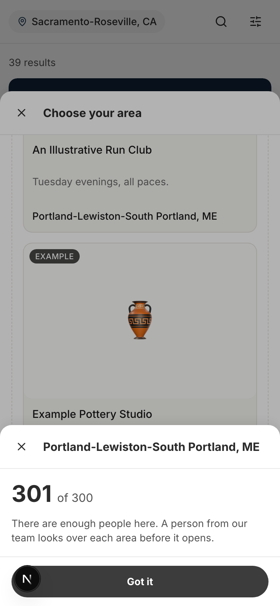

Copy on this screen:

> Portland-Lewiston-South Portland, ME
> 301 of 300
> There are enough people here. A person from our team looks over each area before it opens.
> Got it

## 13. After the popup: the confirmation line

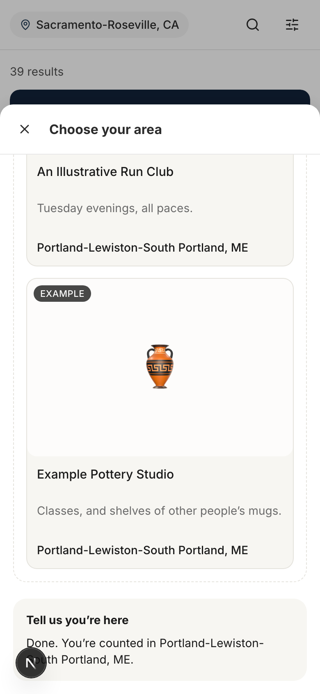

Copy on this screen:

> Tell us you’re here
> Done. You’re counted in Portland-Lewiston-South Portland, ME.

## 14. Explore, signed out: the same panel asks for an email address

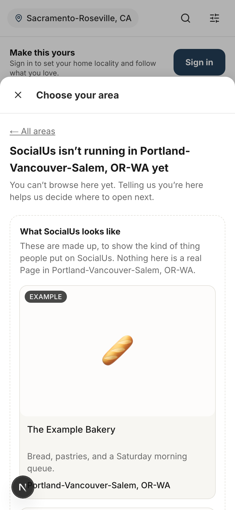

Copy on this screen:

> ← All areas
> SocialUs isn’t running in Portland-Vancouver-Salem, OR-WA yet
> You can’t browse here yet. Telling us you’re here helps us decide where to open next.
> What SocialUs looks like
> These are made up, to show the kind of thing people put on SocialUs. Nothing here is a real Page in Portland-Vancouver-Salem, OR-WA.

## 15. Same panel, scrolled to the role choices, the email box and its note

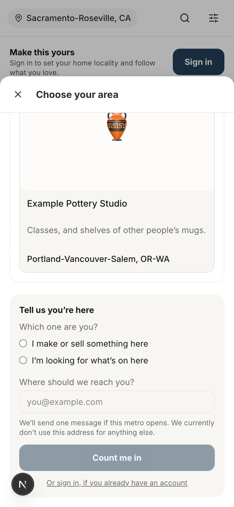

Copy on this screen:

> Tell us you’re here
> Which one are you?
> I make or sell something here
> I’m looking for what’s on here
> Where should we reach you?  (placeholder: you@example.com)
> We’ll send one message if this metro opens. We currently don’t use this address for anything else.
> Count me in
> Or sign in, if you already have an account

## 16. A bad address: the error, in the same slot every failure here uses (today's wording, see item 2)

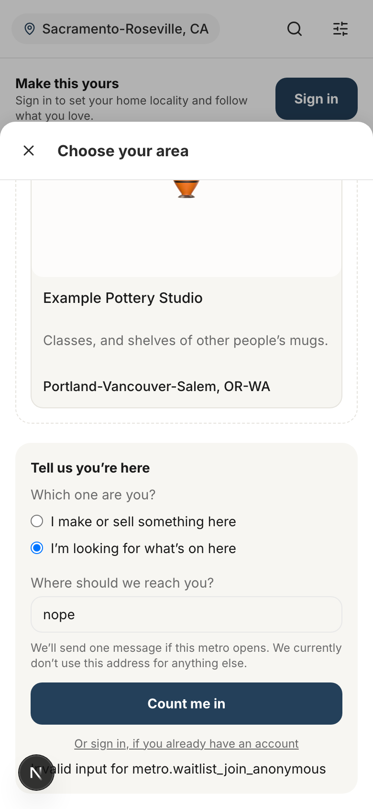

Copy on this screen:

> Invalid input for metro.waitlist_join_anonymous
>
> (the draft line that should show here: That doesn't look like an email address.)

## 17. A good address, signed out: what actually shows today (see item 3)

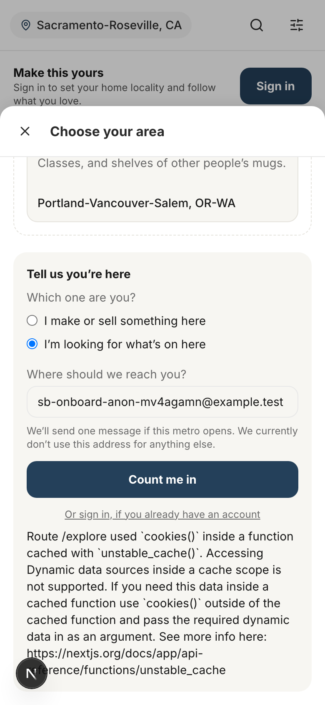

Copy on this screen:

> Route /explore used `cookies()` inside a function cached with `unstable_cache()`. Accessing Dynamic data sources inside a cache scope is not supported. (…)
>
> (what should show here: the popup of shot 9, then "Done. You’re counted in Portland-Vancouver-Salem, OR-WA.")

## Old and new, line by line

| Item | Where | Now (live) | Draft |
|---|---|---|---|
| 3.1 | "Where are you, and why?" step | We are not everywhere yet. Tell us where you are and we will tell you where it stands. | We're not everywhere yet. Tell us where you are and we'll tell you where things stand. |
| 3.2 | Help line under the zip box | It decides your metro. It is never shown to anyone. | It picks your metro. We currently don't show it to anyone. |
| 3.3 | "You're in Sacramento" confirmation | Your zip code decided this. You can change it any time from your account. | Your zip code picked this. You can change it anytime from your account. |
| 3.4 | Phone check step | Everyone here is a real person. We'll text you a code to check. Your number is never shown to anyone. | Everyone here is a real person. We'll text you a code to check. We currently don't show your number to anyone. |
| 3.5 | Waitlist step, fallback error | That did not go through. Try again? | That didn't go through. Mind trying again? |
| 3.6 | 18+ box error | Please confirm you are 18 or older. | Please confirm you're 18 or older. |
| 3.7 | Waitlist panel, second role | I'm looking for what's nearby | I'm looking for what's on here |
| 3.8 | Waitlist panel, fallback error | That did not go through. Try again? | That didn't go through. Mind trying again? |
| 3.9 | Waitlist panel, confirmation | Done — you're counted in {metro}. | Done. You're counted in {metro}. |
| 3.10 | Waitlist panel, email note | One message, if this metro opens. That is the only thing this address is used for — nothing else, ever. | We'll send one message if this metro opens. We currently don't use this address for anything else. |
| 3.11 | Waitlist panel, intro | You can't browse here yet. Telling us you're here is what decides where it opens next. | You can't browse here yet. Telling us you're here helps us decide where to open next. |
| 3.12 | Bad email (server) | That does not look like an email address. | That doesn't look like an email address. |
| 3.13 | Popup, more people needed | This metro needs {n} more people before there is enough here to be worth showing you. | We need {n} more people in {metro} before it's ready to open. We'll let you know. |
| 3.14 | Popup, enough people | Enough people are here. A person reviews each metro before it goes live. | There are enough people here. A person from our team looks over each area before it opens. |
| 3.15 | Interests picker label (no live screen) | Crafts & makers | Crafts |
| 2.4 | Sign-up form, catch-all error | Something went wrong. Try again. | That didn't go through. Mind trying again? |
