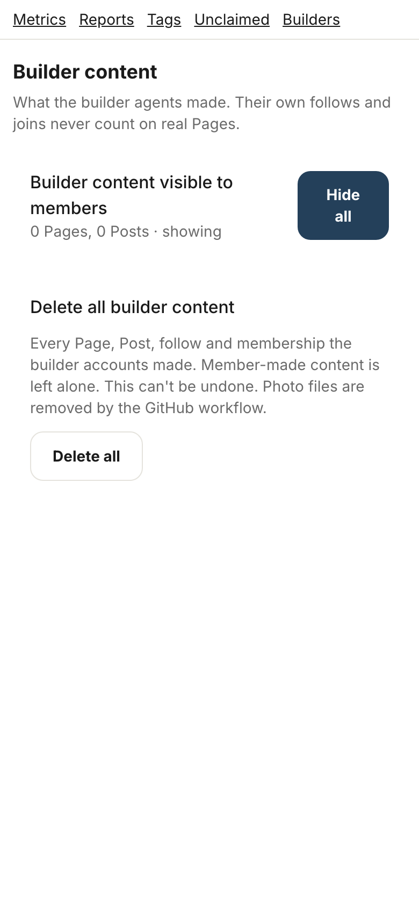
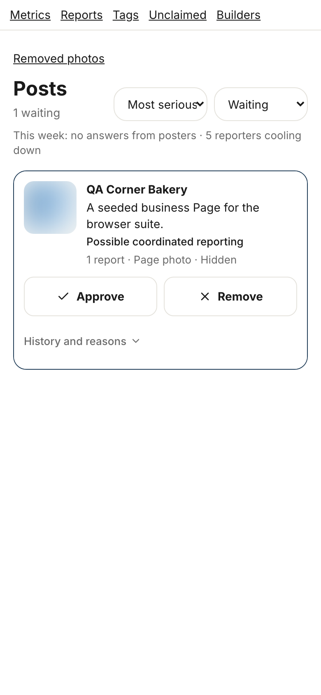
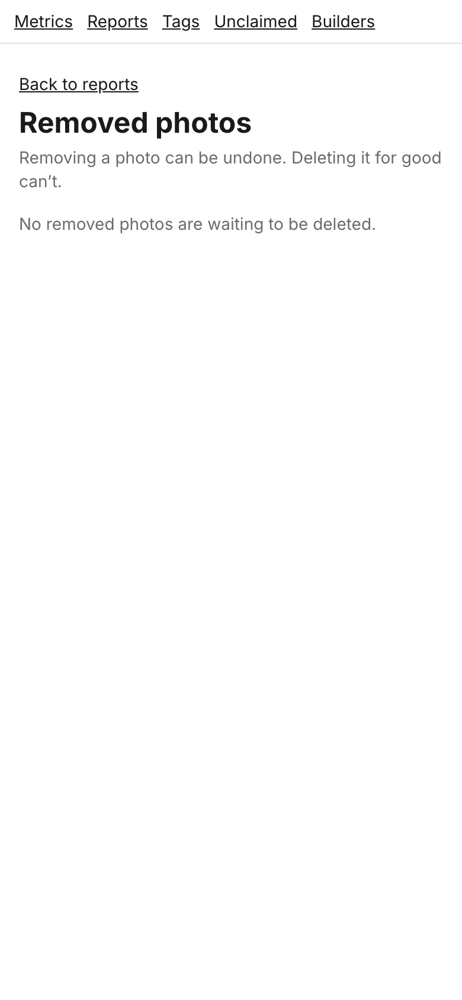
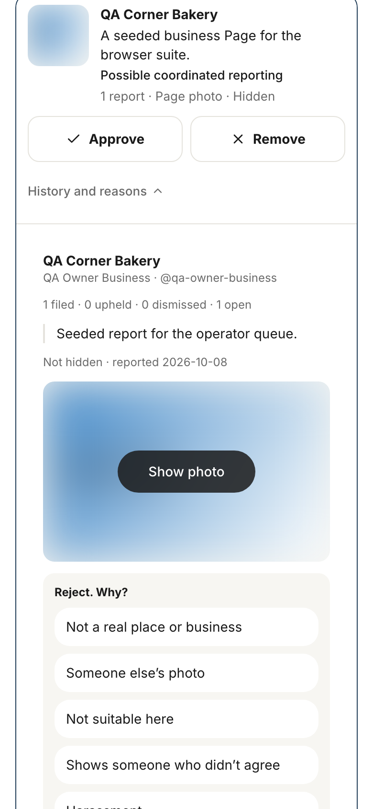

# Storyboard: Operator screens (2026-10-11)

**Draft, not shipped.** Branch `copy/operator-draft`, draft PR [socialus-web#691](https://github.com/donlafranchi/socialus-web/pull/691), not merged. Staff only, so reach is low. Phone width (390px), local database, signed in as the test operator.

## Things you will notice (need your call)

1. **The two operator "Why?" prompts are partly pictured.** "Reject. Why?" is shown (shot 4); "Approve. Why?" and "Undo the removal. Why?" sit behind the same sheet and are applied the same way.
2. **The error lines are not pictured** (11.2, 11.3, 11.4): they show only when a save fails.
3. **Shot 2 and 3 show test data.** The queue has one seeded report; the purge list is empty.

## 1. Builder content

> Every Page, Post, follow and membership the builder accounts made. Member-made content is left alone. This can't be undone. Photo files are removed by the GitHub workflow.

## 2. The review queue

(No copy from §11 shows here; the error line under it is "That didn't go through. Mind trying again?")

## 3. Removed photos, nothing waiting

(Failure line: "That didn't go through. Mind trying again?")

## 4. Rejecting a report

> Reject. Why?
