# Storyboard: Pages, posts and places (2026-10-11)

**Draft, not shipped.** Every line of copy here is a draft on a branch (branch `copy/pages-posts-places-draft`, draft PR [socialus-web#687](https://github.com/donlafranchi/socialus-web/pull/687), not merged). Don reviews it in context first. Phone width (390px), a local database seeded with test members, so names like "QA Corner Bakery" are test data. The small round "N" in the corner is the dev server's badge, not part of the app. Maps show as a broken image because the local stack has no map key.

## Things you will notice (need your call)

1. **The Follow error shows the server's own words.** When the request is cut off, the line under Follow is "Failed to fetch" (shot 4). The new house line ("That didn't go through. Mind trying again?") is only the fallback for an error with no message of its own, so in practice it almost never shows. Options: A) always show the house line under Follow and Join and keep the server's words out of it (recommended); B) leave it; C) map the known server messages to plain lines one by one.
2. **Product and gathering item pages answer by URL but nothing links to them.** The ruling of 2026-10-05 kept them unrouted, yet `/p/ca/sacramento/g/…/p/…` and `…/e/…` still render (shots 2 and 3). I applied "Copied." and the badge anyway, since a shared link would land there. For the badge the report left the wording open; I used "Made in Sacramento" where the owner set a made-at place. Options: A) "Made in Sacramento" (applied); B) keep "Locally Made"; C) hide the badge until product listings come back.
3. **The sample posts say "locals" and "neighbors".** The rewritten sample copy (5.6) keeps "for locals who come by", "Neighbor deal", "Free for neighbors", as the report's own wording does. The rule says people are not a category. Options: A) leave them (they describe who the offer is for, not a kind of person); B) "people who come by" / "people in the area" throughout. The "Sample ·" prefix and the "not a real offer" paragraph are unchanged.
4. **The claim box's "not in proximity" line had an em dash the report did not list.** It now reads "…your Shop's anchor Location, so the badge isn't currently displayed." (shot 13). It still says "Shop" and "anchor Location", old nouns; not in the report, left for a later pass.
5. **Two states needed throwaway data, since the seed has none.** The unclaimed Page (shots 6 to 8) is a test Page added for the shot and removed after; the fallback place label (shot 5) needed QA Street Fair's location moved for a moment and put back; the "Claimed local owner" state (shot 14) needed a county boundary the local stack does not have, added and removed. The row QA Owner Business created in the claim box was removed after.
6. **The owner panel is desktop only.** On a phone the owner's tools are the strip in shot 9; from 1024px wide they are the side panel in shot 18, captured at desktop width.
7. **Browser-tab titles still carry an em dash** ("Oak Park — California", "QA Corner Bakery meetup — SocialUs"). Those are section 1's items and are not applied on this branch.
8. **Not captured:** the venue page strings (5.1, 5.5, 5.10: `/p/…/l/…` is a 404, venue pages retired 2026-10-06; left unchanged), the ownership badge (5.3, rendered nowhere) and ownership picker (5.20, unreferenced), both left unchanged; the opening-hours errors (5.11, applied, but the hours editor is behind a flag that is off, and the server would show them with a "group.update:" prefix, section 6's job); the handle fallback "That doesn't look right." (5.12, applied, but every check carries its own hint so it cannot appear); the "That didn't save" and the claim-removal error (5.19, applied, fallbacks for an error with no message); "Posting…" (5.17, applied; a transient state that would create a post). There is no standalone post page: a post lives on its Page and in Explore.

## 1. A place page (Oak Park), signed out: the placeholder body

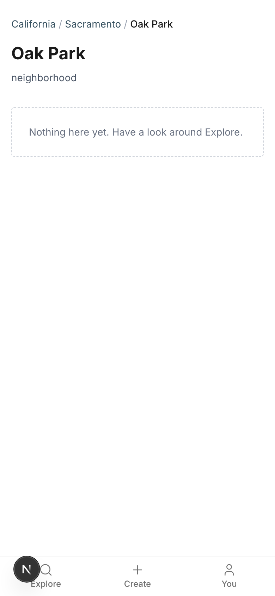

Copy on this screen:

> Browser tab: Oak Park — California
> Link preview: Browse what's happening in Oak Park.
> California
> /
> Sacramento
> /
> Oak Park
> Oak Park
> neighborhood
> Nothing here yet. Have a look around Explore.

## 2. A gathering item page after tapping Share link: "Copied." (this page resolves by URL only; nothing links to it)

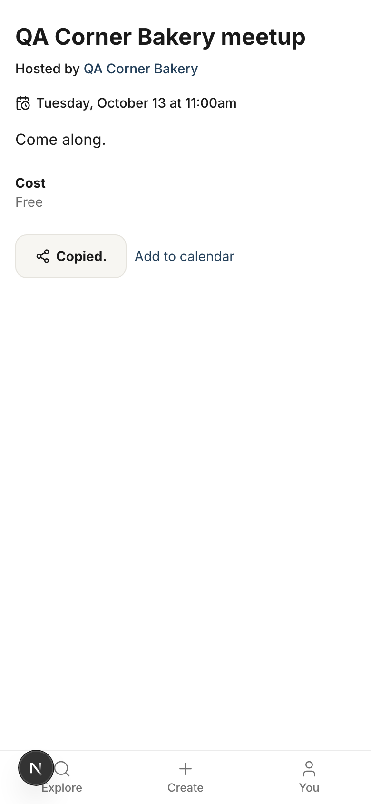

Copy on this screen:

> Browser tab: QA Corner Bakery meetup — SocialUs
> Link preview: Come along.
> Copied.

## 3. A product item page with the badge: "Made in Sacramento" (resolves by URL only; nothing links to it)

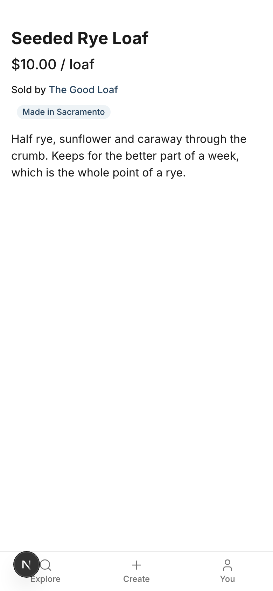

Copy on this screen:

> Browser tab: Seeded Rye Loaf — SocialUs
> Link preview: Half rye, sunflower and caraway through the crumb. Keeps for the better part of a week, which is the whole point of a rye.
> Made in Sacramento

## 4. Follow fails (the request was cut off): the line under the button

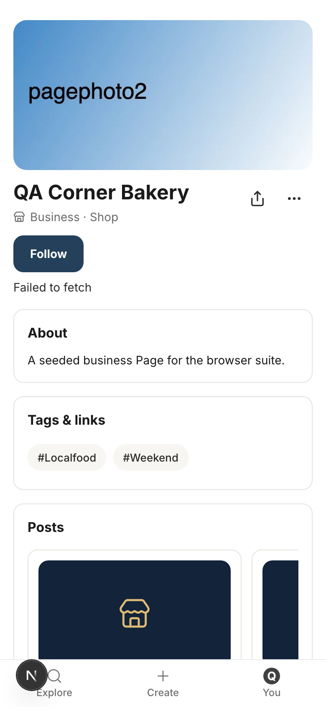

Copy on this screen:

> Follow
> Failed to fetch

## 5. A Page whose area has no neighborhood under it: the fallback place label

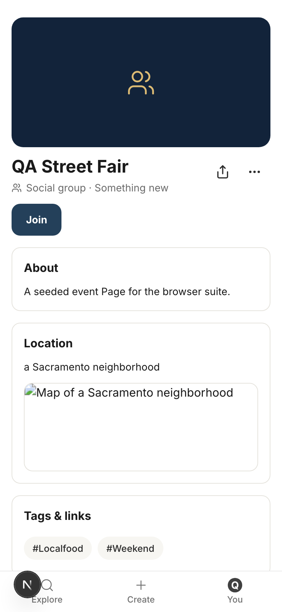

Copy on this screen:

> a Sacramento neighborhood

## 6. An unclaimed business Page (throwaway test data), top

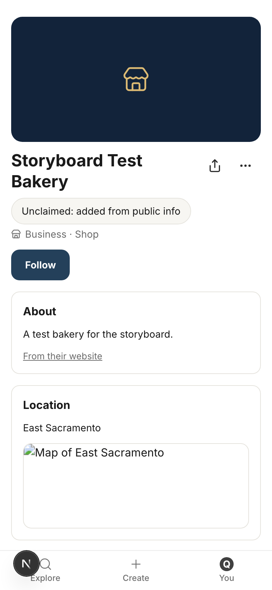

Copy on this screen:

> Storyboard Test Bakery
> Unclaimed: added from public info
> Business · Shop
> Follow
> About
> A test bakery for the storyboard.
> From their website
> Location
> East Sacramento
> Posts
> Sample · Open spots tomorrow morning at Storyboard Test Bakery: a few seats left for our small-group tasting. Walk-ins welcome.
> This is a sample post showing what Storyboard Test Bakery's Page could look like. It is not a real offer. Locals will find posts like this on the Page and in Explore, and can follow the Page to see them first.
> Monday, October 12 at 10:00am–2:00pm
> How to find us: Sacramento: look for Storyboard Test Bakery on SocialUs.
> Add to calendar
> October 11
> Sample · This week at Storyboard Test Bakery: 15% off your first order when you mention SocialUs.
> This is a sample post showing what Storyboard Test Bakery's Page could look like. It is not a real offer. Locals will find posts like this on the Page and in Explore, and can follow the Page to see them first.
> Saturday, October 10 at 5:00pm
> How to find us: Sacramento: look for Storyboard Test Bakery on SocialUs.
> Add to calendar
> October 11
> Sample · Meet the people behind Storyboard Test Bakery: a small tasting, a look behind the counter, and a thank-you for locals who come by.
> This is a sample post showing what Storyboard Test Bakery's Page could look like. It is not a real offer. Locals will find posts like this on the Page and in Explore, and can follow the Page to see them first.
> Wednesday, October 14 at 1:00–4:00pm
> How to find us: Sacramento: look for Storyboard Test Bakery on SocialUs.
> Add to calendar
> October 11
> Products & services
> Nothing posted yet
> This Page hasn't posted anything yet. Check back soon.
> Is this your business?
> We added this Page from public information so neighbors can find you. Claim it to tell your own story, or ask us to take it down.
> Claim this Page
> Ask us to remove it

## 7. The same unclaimed Page, its three sample posts (bakery voice)

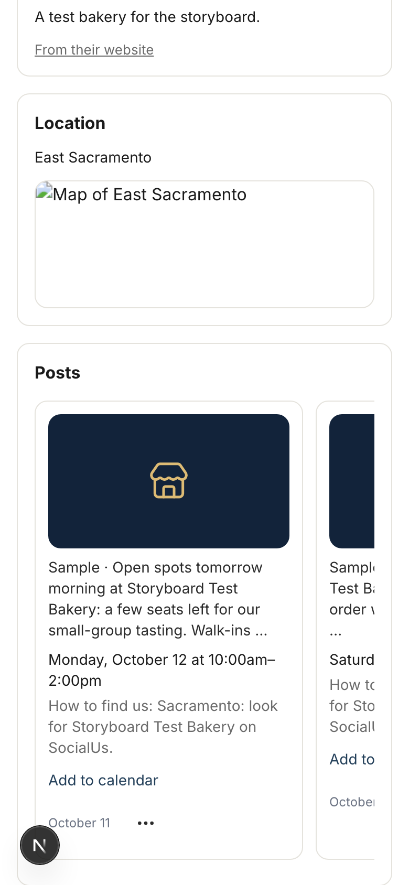

Copy on this screen:

> Posts
> Sample · Open spots tomorrow morning at Storyboard Test Bakery: a few seats left for our small-group tasting. Walk-ins welcome.
> This is a sample post showing what Storyboard Test Bakery's Page could look like. It is not a real offer. Locals will find posts like this on the Page and in Explore, and can follow the Page to see them first.
> Monday, October 12 at 10:00am–2:00pm
> How to find us: Sacramento: look for Storyboard Test Bakery on SocialUs.
> Add to calendar
> October 11
> Sample · This week at Storyboard Test Bakery: 15% off your first order when you mention SocialUs.
> This is a sample post showing what Storyboard Test Bakery's Page could look like. It is not a real offer. Locals will find posts like this on the Page and in Explore, and can follow the Page to see them first.
> Saturday, October 10 at 5:00pm
> How to find us: Sacramento: look for Storyboard Test Bakery on SocialUs.
> Add to calendar
> October 11
> Sample · Meet the people behind Storyboard Test Bakery: a small tasting, a look behind the counter, and a thank-you for locals who come by.
> This is a sample post showing what Storyboard Test Bakery's Page could look like. It is not a real offer. Locals will find posts like this on the Page and in Explore, and can follow the Page to see them first.
> Wednesday, October 14 at 1:00–4:00pm
> How to find us: Sacramento: look for Storyboard Test Bakery on SocialUs.
> Add to calendar
> October 11

## 8. The sample posts, scrolled on

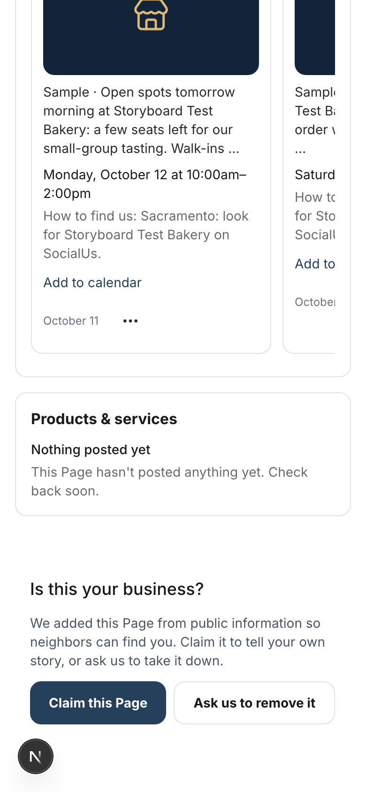

Copy on this screen:

> (see shot 7 for the full sample text)

## 9. The owner's own Page: the owner strip

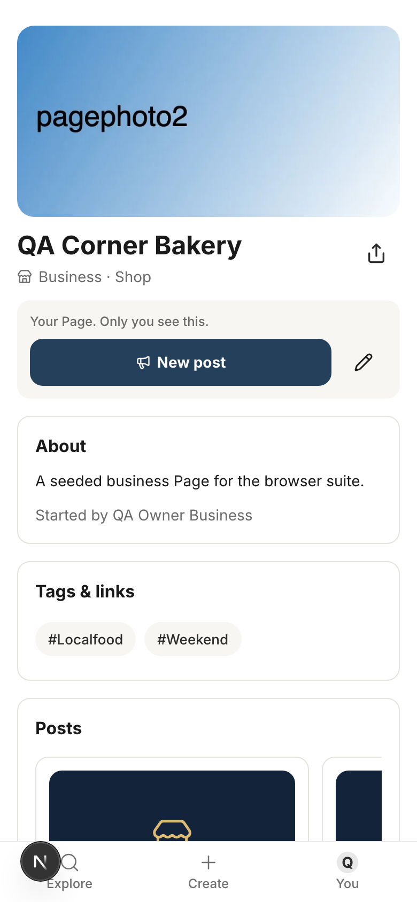

Copy on this screen:

> Your Page. Only you see this.
> New post

## 10. The post composer, open from New post, scrolled to its end: the button says Post it

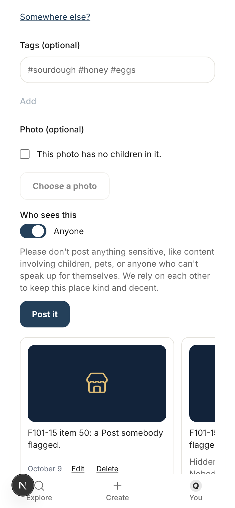

Copy on this screen:

> Who sees this
> Anyone
> Please don't post anything sensitive, like content involving children, pets, or anyone who can't speak up for themselves. We rely on each other to keep this place kind and decent.
> Post it

## 11. The Locally Owned claim box, nothing claimed yet

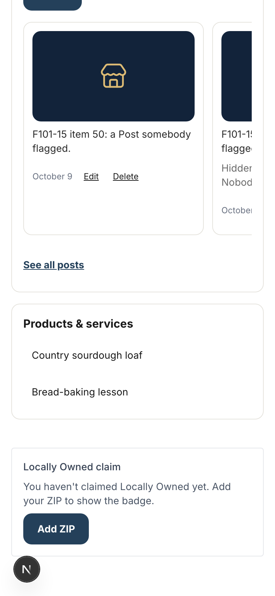

Copy on this screen:

> Locally Owned claim
> You haven't claimed Locally Owned yet. Add your ZIP to show the badge.
> Add ZIP

## 12. A short ZIP: the check line

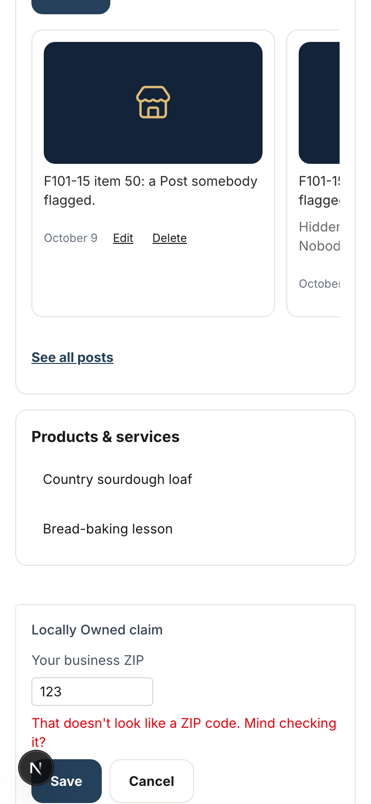

Copy on this screen:

> Locally Owned claim
> Your business ZIP
> That doesn't look like a ZIP code. Mind checking it?
> Save
> Cancel

## 13. A ZIP far from the Page: the not-in-proximity line (its em dash is out too)

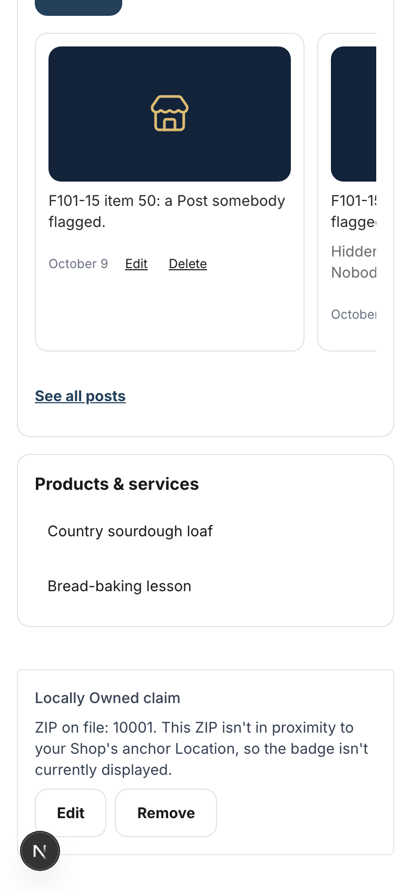

Copy on this screen:

> Locally Owned claim
> ZIP on file: 10001. This ZIP isn't in proximity to your Shop's anchor Location, so the badge isn't currently displayed.
> Edit
> Remove

## 14. A Sacramento ZIP: claimed, ZIP on file

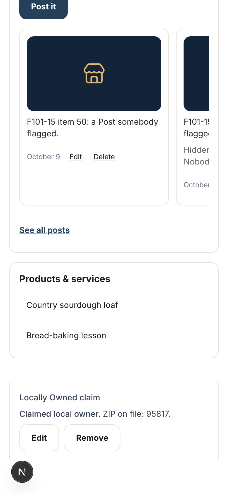

Copy on this screen:

> Locally Owned claim
> Claimed local owner. ZIP on file: 95817.
> Edit
> Remove

## 15. The Edit screen's "How people find you" sheet: the links hint

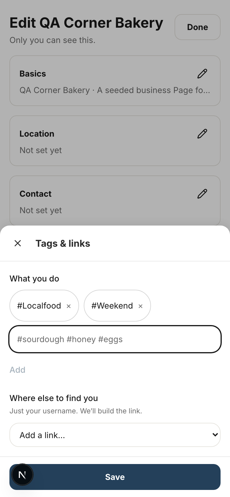

Copy on this screen:

> Where else to find you
> Just your username. We’ll build the link.
> Add a link
> Add a link…
> Instagram
> Facebook
> TikTok
> X
> YouTube
> Bluesky
> Website

## 16. A Bluesky handle with a space: the hint under the field

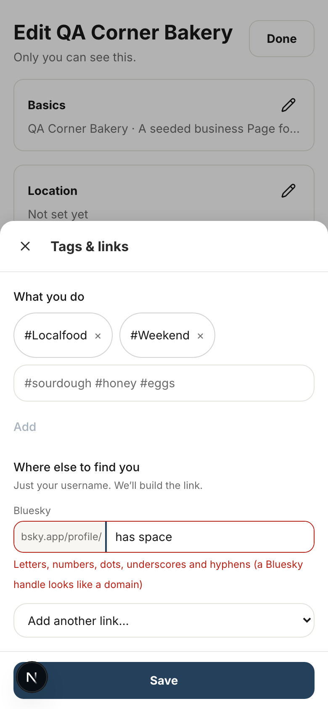

Copy on this screen:

> Field aria-label: Bluesky, bsky.app/profile/
> Where else to find you
> Just your username. We’ll build the link.
> Bluesky
> bsky.app/profile/
> Letters, numbers, dots, underscores and hyphens (a Bluesky handle looks like a domain)
> Add a link
> Add another link…
> Instagram
> Facebook
> TikTok
> X
> YouTube
> Website

## 17. Saving with the bad handle: the line above Save

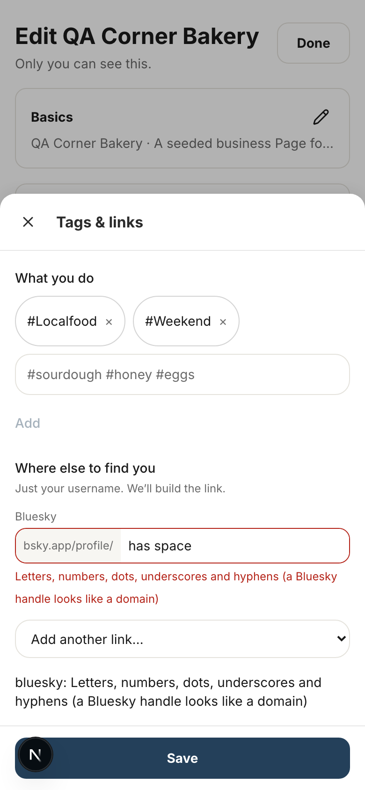

Copy on this screen:

> bluesky: Letters, numbers, dots, underscores and hyphens (a Bluesky handle looks like a domain)

## 18. From 1024px wide the owner strip is a side panel (desktop, not phone): New post

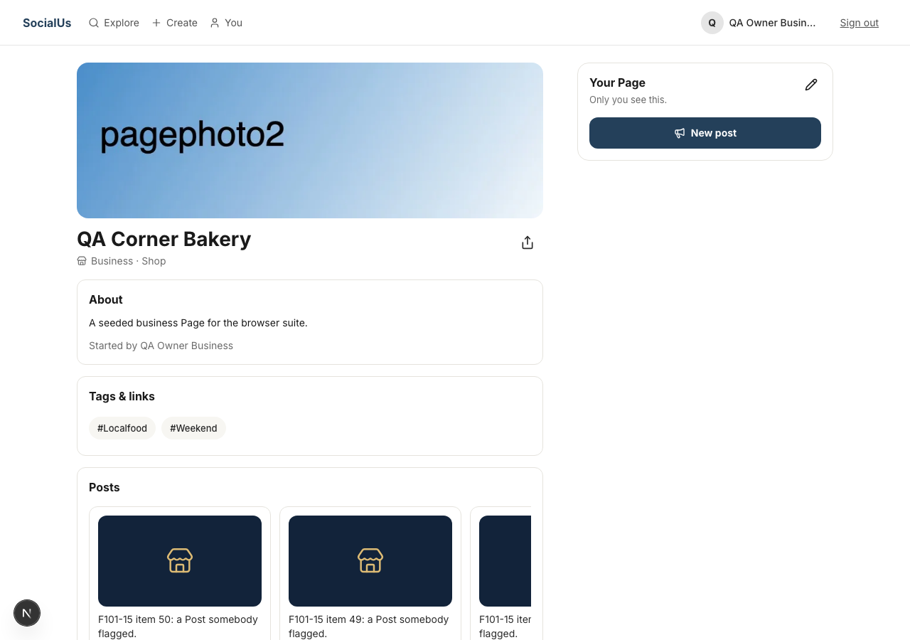

Copy on this screen:

> Your Page
> Only you see this.
> New post

## Old and new, line by line

| Where | Now (live) | Draft |
|---|---|---|
| Place page body (5.2) | The curated landing for this place ships at b2 (places.md § T2). For now, you've confirmed the URL resolves and the place tree is wired. | Nothing here yet. Have a look around Explore. |
| Fallback place label on a Page (5.4) | a nearby neighbourhood | a Sacramento neighborhood |
| Sample posts, food (5.6) | Meet the maker night at {name}: … / This week only at {name}: 15% off … / Open spots tomorrow morning … Walk-ins welcome while they last. / First 20 people … | Meet the people behind {name}: … / This week at {name}: 15% off … / Open spots tomorrow morning … Walk-ins welcome. / The first 20 people … |
| Sample posts, makers (5.6) | Maker pop-up with {name}: … a local-only first look. / Last-minute opening at {name}: … / … available tomorrow only. | Pop-up with {name}: … a first look for locals. / An opening at {name}: … / … in the shop tomorrow. |
| Sample posts, trades (5.6) | 10% off your first repair for people nearby. | 10% off your first repair for people in the area. |
| Sample posts, farm (5.6) | … priced for neighbours who pick it up. / … available tomorrow morning while it lasts. | … priced for neighbors who pick it up. / … ready tomorrow morning. |
| Sample posts, stay (5.6) | Free for neighbours. / Last-minute opening at {name} this weekend: a cancellation freed up a room. Book it before it goes. / Tonight only at {name}: … | Free for neighbors. / An opening at {name} this weekend: a cancellation freed up a room. / Tonight at {name}: … |
| Sample posts, local (5.6) | Neighbourhood open house … / Meet your neighbours … / Local-only offer at {name}: … / Bring a neighbour … / Something new at {name} tomorrow only: … / A few last-minute spots open … | Neighborhood open house … / Meet your neighbors … / Local offer at {name}: … / Bring a neighbor … / Something new at {name} tomorrow: … / A few spots open … |
| Product badge (5.7) | Locally Made | Made in Sacramento |
| Share link, after copying (5.8) | Copied! | Copied. |
| Follow/Join error fallback (5.9) | That did not go through. Mind trying again? | That didn't go through. Mind trying again? |
| Opening hours errors (5.11) | Opening hours must be a week of days. / {day}: hours must be a list / {day}: times are HH:MM / {day}: closing comes after opening | Those hours didn't look right. Mind checking them? (both) / {day}: use a time like 9:00. / {day}: closing needs to come after opening. |
| Bluesky hint (5.12) | Letters, numbers, dots, underscores and hyphens — a Bluesky handle looks like a domain | Letters, numbers, dots, underscores and hyphens (a Bluesky handle looks like a domain) |
| Handle fallback (5.12) | That does not look right | That doesn't look right. |
| Links hint (5.13) | Just your username — we'll build the link. | Just your username. We'll build the link. |
| Link field label for screen readers (5.13) | {platform} — {prefix} | {platform}, {prefix} |
| Owner strip (5.14) | Your Page — only you see this | Your Page. Only you see this. |
| Owner strip button (5.15) | Announce | New post |
| Owner panel button (5.16) | Announce | New post |
| Composer button (5.17) | Announce / Announcing | Post it / Posting… |
| Claim box, nothing claimed (5.18) | You haven't claimed Locally Owned yet — add your ZIP to display the badge. | You haven't claimed Locally Owned yet. Add your ZIP to show the badge. |
| Claim box, claimed (5.18) | Claimed local owner — ZIP on file: {zip}. | Claimed local owner. ZIP on file: {zip}. |
| Claim box, not in proximity (not in the report) | … your Shop's anchor Location — the badge isn't currently displayed. | … your Shop's anchor Location, so the badge isn't currently displayed. |
| Claim box, bad ZIP (5.19) | Enter a 5-digit US ZIP code. | That doesn't look like a ZIP code. Mind checking it? |
| Claim box, save failed (5.19) | Could not save your ZIP. | That didn't save. Mind trying again? |
| Claim box, removal failed (5.19) | Could not remove your claim. | That didn't go through. Mind trying again? |
| Venue description, venue heading, venue follow error (5.1, 5.5, 5.10) | unchanged: venue pages are retired and the address is a 404 | |
| Ownership badge and picker (5.3, 5.20) | unchanged: rendered nowhere | |
