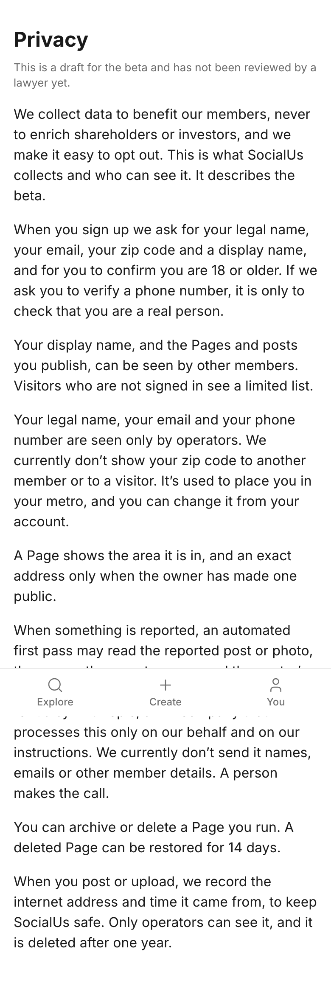

# Storyboard: Privacy (2026-10-11)

**Draft, not shipped.** Branch `copy/privacy-draft`, draft PR [socialus-web#690](https://github.com/donlafranchi/socialus-web/pull/690), not merged. Phone width (390px). The page is a draft for the beta and says so itself. The tab bar appears mid-page only because this is a full-length capture.

## Things you will notice (need your call)

1. **Counsel must approve all three changes before they go live.** 9.1 and 9.2 soften "never" to "currently don't", which changes a stated privacy commitment. 9.3 adds a public data-use and opt-out statement; counsel should confirm what a member can opt out of today and that the path is easy to find.
2. **The opening sentence is the data-stance line from DECISIONS 2026-10-11, word for word.** It carries a second "never" ("never to enrich shareholders or investors"). It is not reworded; flagging it because the copy rules otherwise allow only one.
3. **Terms: the report proposes no change, so none is made.**

## The page

Changed lines:

> We collect data to benefit our members, never to enrich shareholders or investors, and we make it easy to opt out. This is what SocialUs collects and who can see it. It describes the beta.

> We currently don’t show your zip code to another member or to a visitor. It’s used to place you in your metro, and you can change it from your account.

> We currently don’t send it names, emails or other member details. A person makes the call.
