# Storyboard: the report path (2026-10-11)

**Draft, not shipped.** Every line of copy here is a draft on a branch (branch `copy/report-path-draft`, draft PR [socialus-web#678](https://github.com/donlafranchi/socialus-web/pull/678), not merged). Don reviews it in context first. Phone width (390px), a local database seeded with test members, so names like "QA Corner Bakery" are test data. The small round "N" in the corner is the dev server's badge, not part of the app.

Don's edits applied: no numbers in the misuse warning; "a person from our team" everywhere; "help us all be good to one another" as the guide; a plain "we don't tolerate abusive or harmful content" line.

## Things you will notice (need your call)

1. **The sheet opens scrolled to the box.** The text box takes focus when the sheet opens, which scrolls the intro and the new "We don't tolerate" line above the top edge. A phone user sees the reasons first (shot 2) and has to scroll up for those lines (shot 3). Options: A) move the tolerance line down, next to the misuse warning; B) stop the box taking focus on open; C) leave it.
2. **Server error words show as they are.** A third report on the same Page shows "report.create: you have already reported this one — we have it", with a developer prefix and an em dash (shot 14). The copy pass (section 7) already proposes plain wording; it is not applied here.
3. **A "Sensitive content" report hides the post but sends the poster no notice** (ruled 2026-10-07: a child's picture does not go back to the poster). So the poster notice and answer screens below are shown for "Threat of harm". The poster notice wording for Sensitive content is not displayed today.
4. **A signed-out visitor who taps "Report this" lands on the plain sign-in page**, not a prompt that says why (shot 21). The "Sign in to report this" wording in the code is not what appears here.
5. **Not captured:** the hidden-photo notice on a Page (the test data has no photos), the operator's screens, and the limits message ("you have a lot of reports open").

## 1. A Page, its menu open: the one item is "Report this"

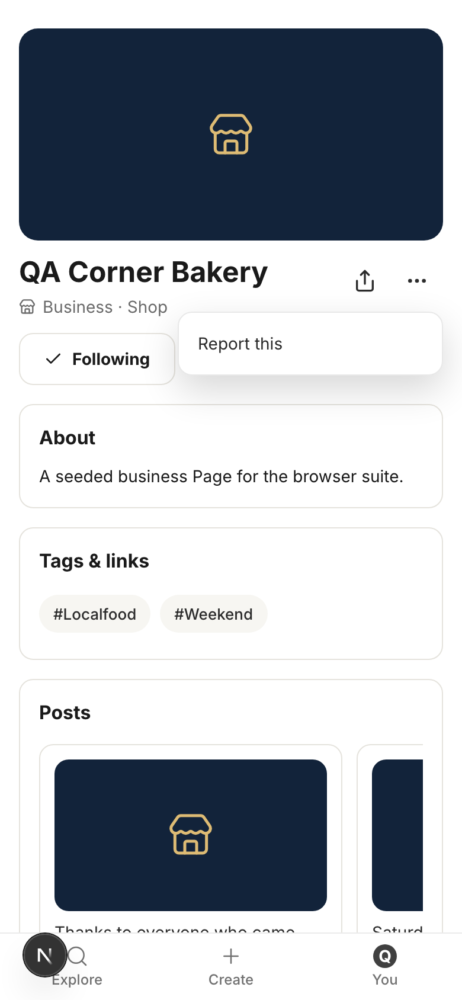

Copy on this screen:

> Report this

## 2. The report sheet as it opens on a phone: it opens scrolled to the box, so the intro and the new line are above the top edge

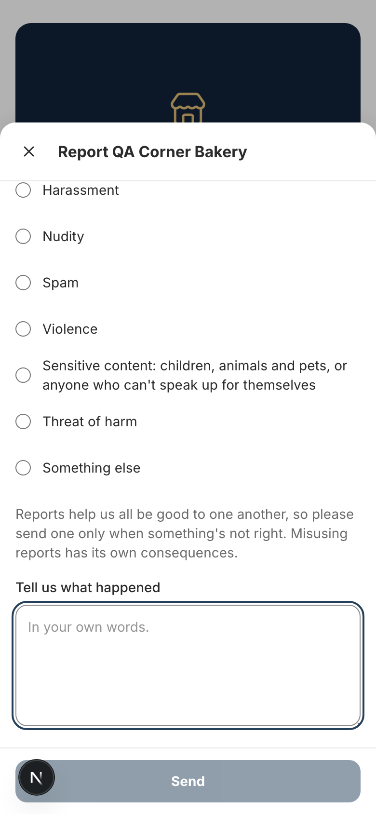

Copy on this screen:

> Report QA Corner Bakery
> A person from our team reads this. Thanks for helping us all be good to one another.
> We don’t tolerate abusive or harmful content.
> Why are you reporting this?
> Harassment
> Nudity
> Spam
> Violence
> Sensitive content: children, animals and pets, or anyone who can't speak up for themselves
> Threat of harm
> Something else
> Reports help us all be good to one another, so please send one only when something's not right. Misusing reports has its own consequences.
> Tell us what happened
> Send

## 3. The same sheet scrolled to the top: the intro line and "We don't tolerate" line

Copy on this screen:

> A person from our team reads this. Thanks for helping us all be good to one another.
>
> We don't tolerate abusive or harmful content.
>
> Why are you reporting this?

## 4. Same sheet, scrolled to the misuse warning and the box

Copy on this screen:

> Reports help us all be good to one another, so please send one only when something's not right. Misusing reports has its own consequences.

## 5. Reason picked: Harassment

Copy on this screen:

> Harassment

## 6. Reason picked: Nudity

Copy on this screen:

> Nudity

## 7. Reason picked: Spam

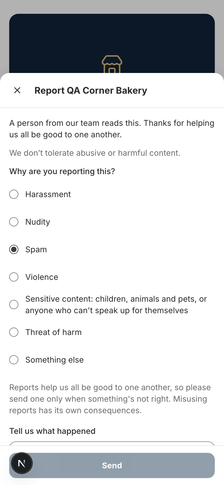

Copy on this screen:

> Spam

## 8. Reason picked: Violence

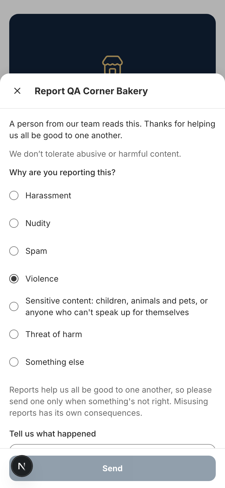

Copy on this screen:

> Violence

## 9. Reason picked: Sensitive content

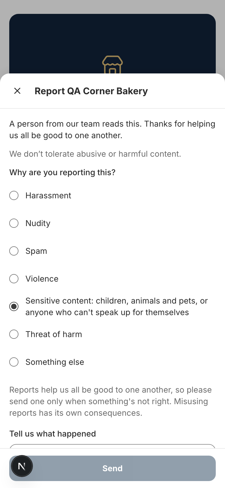

Copy on this screen:

> Sensitive content: children, animals and pets, or anyone who can't speak up for themselves

## 10. Reason picked: Threat of harm (the 911 line shows)

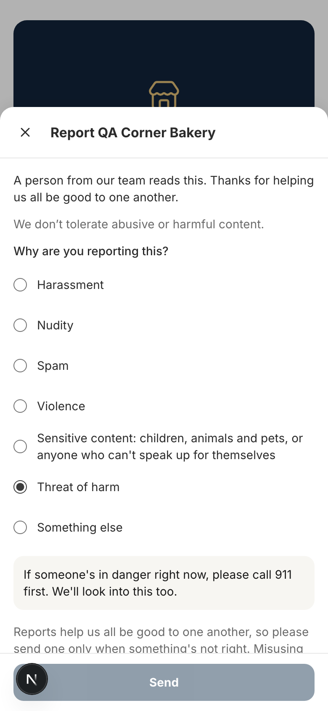

Copy on this screen:

> If someone's in danger right now, please call 911 first. We'll look into this too.

## 11. Reason picked: Other

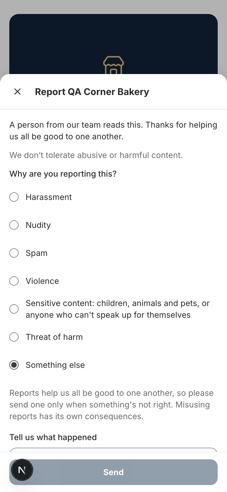

Copy on this screen:

> Something else

## 12. Ready to send: Spam, with a few words

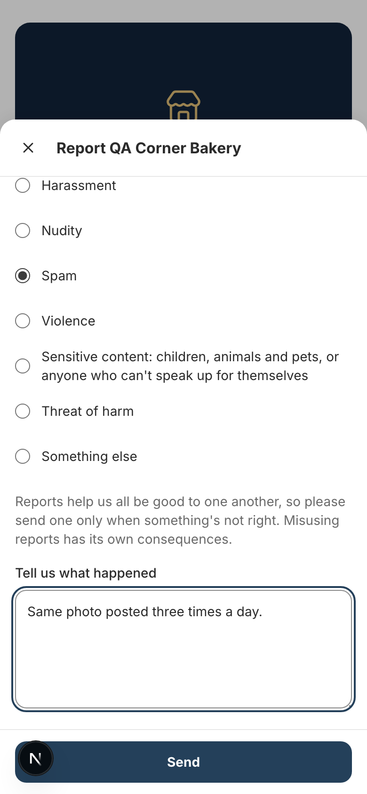

Copy on this screen:

> Tell us what happened  (placeholder: In your own words.)
>
> Send

## 13. After sending: the confirmation at the bottom

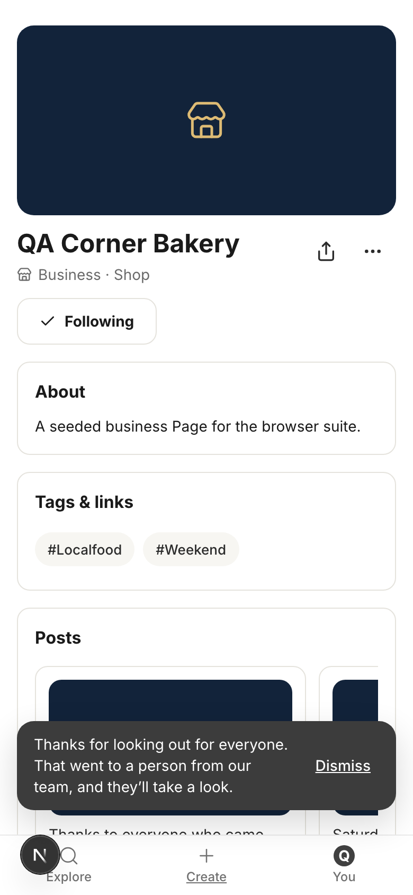

Copy on this screen:

> Thanks for looking out for everyone. That went to a person from our team, and they’ll take a look.
> Dismiss

## 14. The error state: a third report on the same Page. The server's own wording shows as it is (the line sits right above Send; on first appearance it was below the fold)

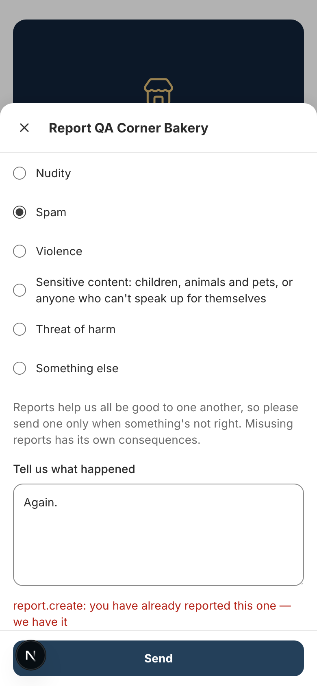

Copy on this screen:

> report.create: you have already reported this one — we have it

## 15. Reporting a Post: the same sheet, opened from the Post menu

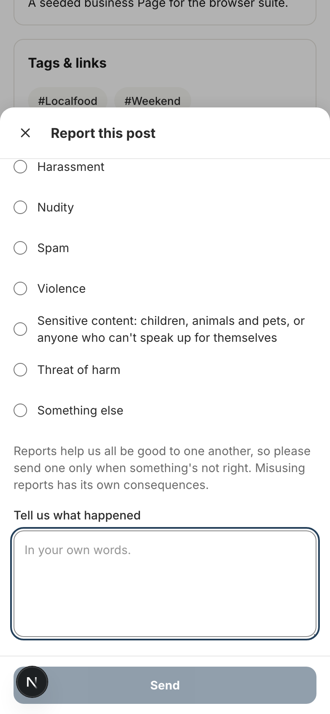

Copy on this screen:

> Report this post
> A person from our team reads this. Thanks for helping us all be good to one another.
> We don’t tolerate abusive or harmful content.
> Why are you reporting this?
> Harassment
> Nudity
> Spam
> Violence
> Sensitive content: children, animals and pets, or anyone who can't speak up for themselves
> Threat of harm
> Something else
> Reports help us all be good to one another, so please send one only when something's not right. Misusing reports has its own consequences.
> Tell us what happened
> Send

## 16. After sending a Post report (Threat of harm hides the Post straight away and tells the poster)

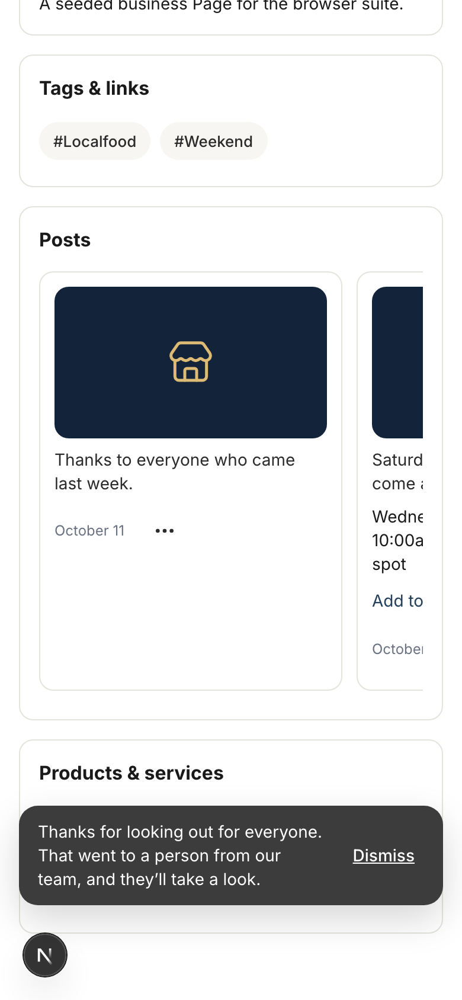

Copy on this screen:

> Thanks for looking out for everyone. That went to a person from our team, and they’ll take a look.
> Dismiss

## 17. The poster sees a notice on You

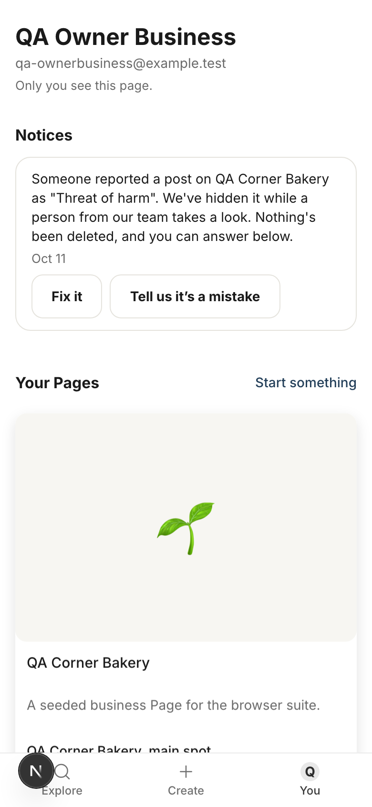

Copy on this screen:

> Notices
> Someone reported a post on QA Corner Bakery as "Threat of harm". We've hidden it while a person from our team takes a look. Nothing's been deleted, and you can answer below.
> Oct 11
> Fix it
> Tell us it’s a mistake

## 18. The answer screen: pick what best fits, say what happened

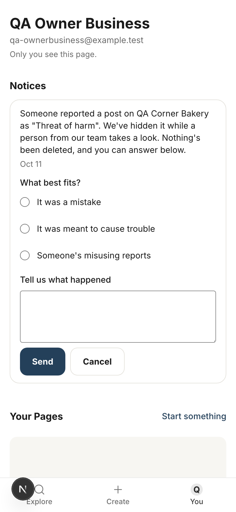

Copy on this screen:

> Notices
> Someone reported a post on QA Corner Bakery as "Threat of harm". We've hidden it while a person from our team takes a look. Nothing's been deleted, and you can answer below.
> Oct 11
> What best fits?
> It was a mistake
> It was meant to cause trouble
> Someone's misusing reports
> Tell us what happened
> Send
> Cancel

## 19. After answering

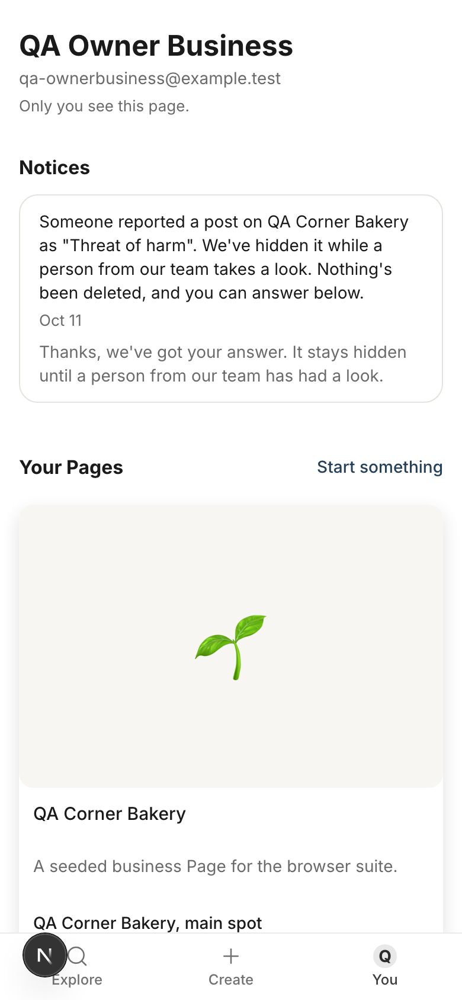

Copy on this screen:

> Thanks, we've got your answer. It stays hidden until a person from our team has had a look.

## 20. A notice past the 14-day window: closed

Copy on this screen:

> This one’s closed. Nothing more needed from you.

## 21. A signed-out visitor taps "Report this": they land on sign-in

Copy on this screen:

> SocialUs
> Sign in to SocialUs
> Enter your email and we’ll send you a link. New here or not, this is the way in.
> Email me a sign-in link
> Use a password instead

## Old and new, line by line

| Where | Now (live) | Draft |
|---|---|---|
| Sheet intro | This goes to a person, not a queue. | A person from our team reads this. Thanks for helping us all be good to one another. |
| New line on the sheet | | We don't tolerate abusive or harmful content. |
| Box label | What's wrong? | Tell us what happened |
| Misuse warning | Reports help keep everyone safe, so please send one only when something's wrong. A report that didn't match a rule is counted. After three, your reports stop hiding anything while a person looks. | Reports help us all be good to one another, so please send one only when something's not right. Misusing reports has its own consequences. |
| 911 line | If someone is in danger right now, please call 911 first. We'll look at this too. | If someone's in danger right now, please call 911 first. We'll look into this too. |
| Sensitive content reason | Sensitive content — children, animals and pets, or anyone who can't fend for themselves | Sensitive content: children, animals and pets, or anyone who can't speak up for themselves |
| Menu item | Report to the operator | Report this |
| Sent | Thank you — that went to a person, and they'll take a look. | Thanks for looking out for everyone. That went to a person from our team, and they'll take a look. |
| Send failed (no message) | That did not send. Try again? | That didn't go through. Mind trying again? |
| Poster notice | Someone reported a post on X as "Y", so we've hidden it while we take a look. Nothing is deleted. | Someone reported a post on X as "Y". We've hidden it while a person from our team takes a look. Nothing's been deleted, and you can answer below. |
| Hidden photo notice | Someone let us know about it, and a person is taking a look. | Someone let us know about it, and a person from our team is taking a look. |
| Answer button | Say it's a mistake | Tell us it's a mistake |
| Answer choices | Mistaken / Malicious / Misusing reports | It was a mistake / It was meant to cause trouble / Someone's misusing reports |
| Answer failed | That didn't go through. Please try again. | That didn't go through. Mind trying again? |
| After answering | We've got your answer. It stays hidden until a person has had a look. | Thanks, we've got your answer. It stays hidden until a person from our team has had a look. |
| Closed | This one has closed. Nothing more is needed from you. | This one's closed. Nothing more needed from you. |
| While sending (poster) | Sending… | One sec… |
