# Storyboard: sign in and sign up (2026-10-11)

**Draft, not shipped.** Every line of copy here is a draft on a branch (branch `copy/sign-in-draft`, draft PR [socialus-web#682](https://github.com/donlafranchi/socialus-web/pull/682), not merged). Don reviews it in context first. Phone width (390px), a local database seeded with test members, so names like "QA Corner Bakery" and `sb-signin-…@example.test` are test data. The small round "N" in the corner is the dev server's badge, not part of the app. Nothing was emailed: the mail-sending calls were answered by a stub so no sign-in email went out and no rate limit tripped.

Copy report §2, items 2.1 to 2.13, all applied as written. The copy rules did not force any departure from the report's wording.

## Things you will notice (need your call)

1. **Two sign-in screens, two looks.** The public way in is `/auth/login` (shots 1 to 3): the wordmark, a card, "Sign in to SocialUs". The email-first flow with a password (shots 4 to 13) lives at `/auth/password`, an unlinked route kept for the test suite, and it has its own plainer layout with a "Sign in with a password" heading over it. Most of section 2 lives on that second screen, so a member only meets it if they find the route. Your call whether that screen should match the card, or whether the section 2 lines should move to the public form.
2. **The "already have an account" error reads above a "Welcome back" heading** (shot 10). The screen switches to the returning-member view and then says "Looks like you already have an account. Enter your password to sign in." The heading and the error say nearly the same thing; one of them could go.
3. **The gate modal has no live trigger.** `AuthGateModal` (items 2.9 and 2.12: "We'll email you a link. No password, and it only takes a minute." and "Run a business? Start a Page for it.") is only mounted on the Following screen, which a signed-out visitor cannot reach, and a Page's follow button opens the prompt sheet instead (shot 14). The wording is applied on the branch but there is no screen to show it on. Options: A) retire the modal and keep the sheet; B) fold its two lines into the sheet; C) leave it.
4. **Two of the prompt lines are not shown anywhere today.** "Updates show up in the app, not in your inbox." (2.10) has no control that uses it, and "Sign in to report this" with "An account lets us slow down anyone reporting the same business over and over. It's not an identity check." (2.13) is skipped: a signed-out tap on Report goes straight to the plain sign-in page (shot 16). Both are applied on the branch; neither is on screen.
5. **The browser tab reads "SocialUs" on both sign-in screens** and the shared description still says "the people near you" ("near you" is banned while there is one metro). That is section 1's work, not this branch; noted so you are not surprised by it in shots 1 and 4.
6. **"Working…" was only in the email-first flow.** The report says the phone-verify step has it too; it does not (that step has no working label). Nothing to change there.
7. **Not captured:** the catch-all error on the onboarding name step (`OnboardingFlow`, named under 2.4) is section 3's surface and is left for that storyboard; the sign-in email and text-message code (§12.1) live in the Supabase dashboard, outside the repo, so they are not applied here, and the report proposes moving the template into `supabase/templates` so it can be reviewed like the rest; the "Confirm your email" screen (shot 12) only appears in production, where new accounts need confirming, so it is shown here by stubbing the sign-up call.

## 1. Sign in (/auth/login): the magic-link form

Copy on this screen:

> Browser tab: SocialUs
> Description: Find and support the people near you. Meet your neighbors, trade what you make, volunteer where it's needed, and share an idea before you build it.
> SocialUs
> Sign in to SocialUs
> Enter your email and we'll send you a link. New here or not, this is the way in.
> Email me a sign-in link
> Use a password instead

## 2. Sign in: a bad email address

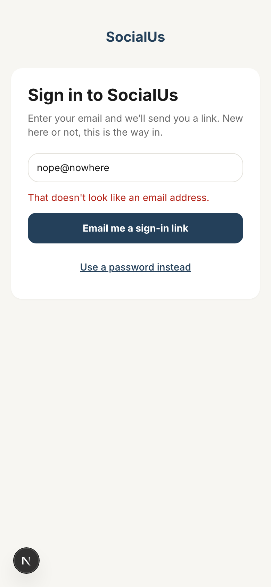

Copy on this screen:

> That doesn't look like an email address.

## 3. Sign in: "Check your email" after asking for a link (this form's own wording, unchanged by section 2)

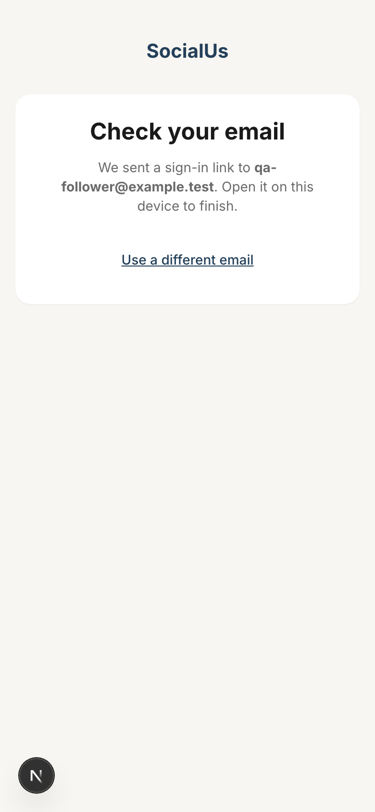

Copy on this screen:

> Check your email
> We sent a sign-in link to qa-follower@example.test. Open it on this device to finish.
> Use a different email

## 4. The email-first flow (/auth/password, the unlinked password route): the email box

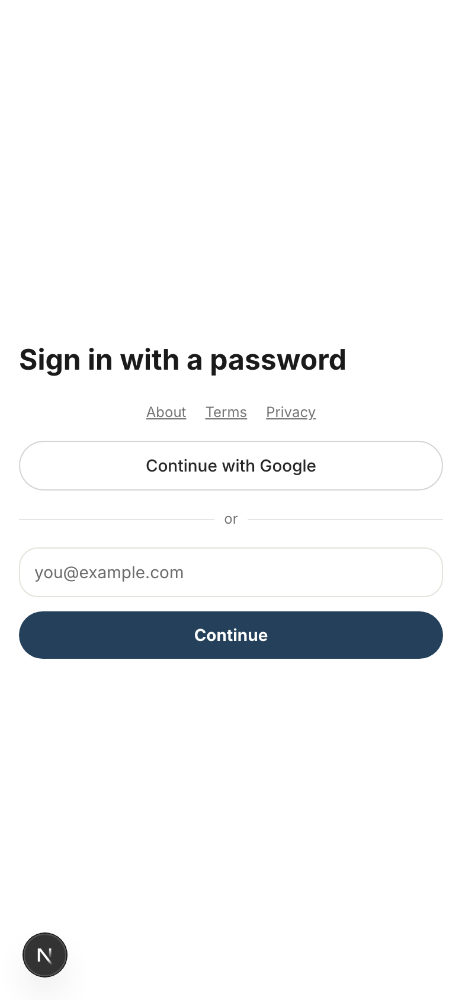

Copy on this screen:

> Browser tab: SocialUs
> Sign in with a password
> About · Terms · Privacy
> Continue with Google
> or
> (placeholder: you@example.com)
> Continue

## 5. Email-first: a bad email address

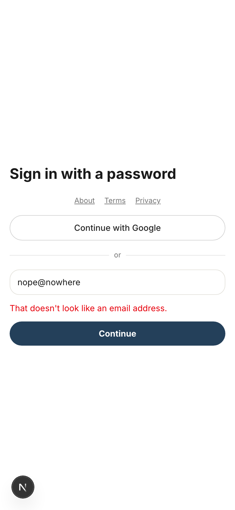

Copy on this screen:

> That doesn't look like an email address.

## 6. Email-first: the lookup failed (the catch-all error)

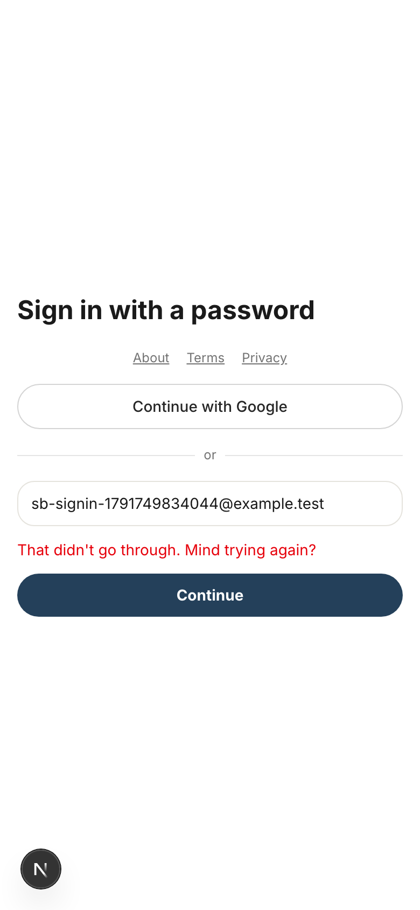

Copy on this screen:

> That didn't go through. Mind trying again?

## 7. Email-first: the button while it works (the network was slowed to catch it)

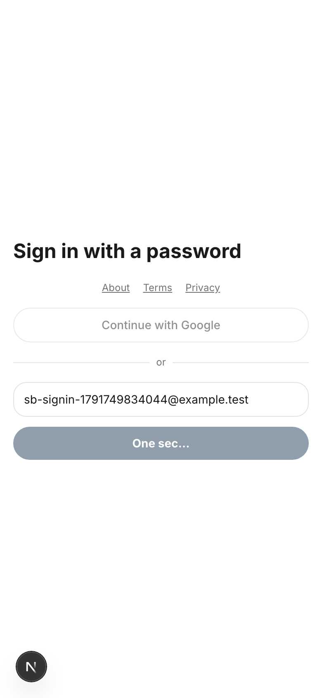

Copy on this screen:

> One sec…

## 8. A new email: "Set a password", with the link under the password box

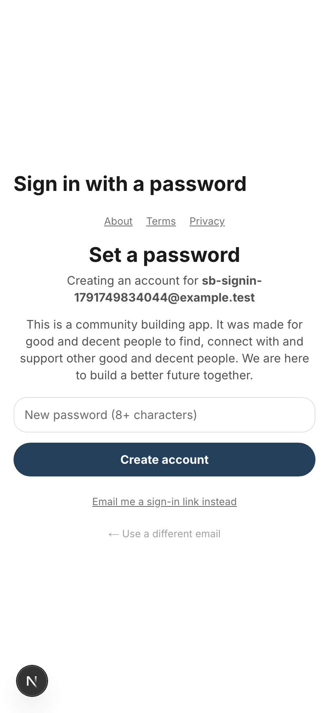

Copy on this screen:

> Set a password
> Creating an account for sb-signin-…@example.test
> This is a community building app. It was made for good and decent people to find, connect with and support other good and decent people. We are here to build a better future together.
> (placeholder: New password (8+ characters))
> Create account
> Email me a sign-in link instead
> ← Use a different email

## 9. Set a password: too short

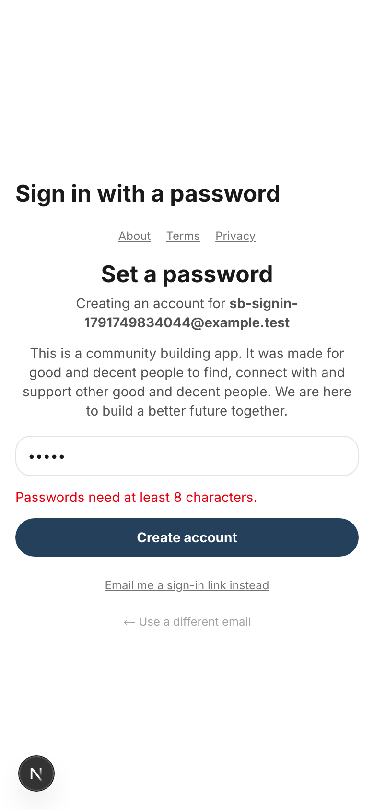

Copy on this screen:

> Passwords need at least 8 characters.

## 10. The email already has an account (it switches to "Welcome back" and says so)

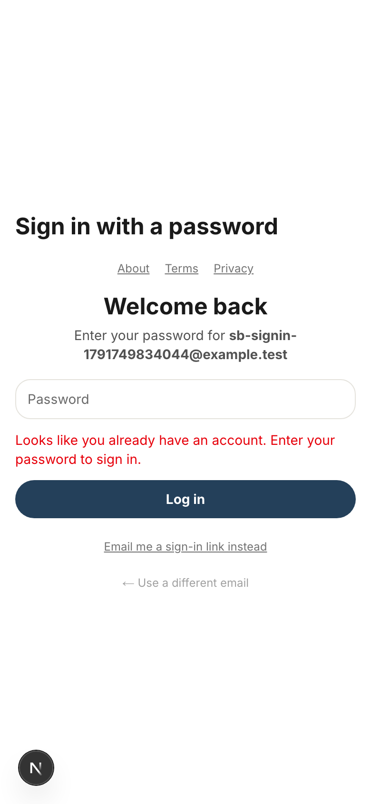

Copy on this screen:

> Welcome back
> Enter your password for sb-signin-…@example.test
> Looks like you already have an account. Enter your password to sign in.
> Log in
> Email me a sign-in link instead
> ← Use a different email

## 11. "Check your email" after asking for a sign-in link from the password screen

Copy on this screen:

> Check your email
> We sent a sign-in link to sb-signin-…@example.test. Tap it to finish. No password needed.
> Use a different email

## 12. "Confirm your email" (what production shows when a new account needs confirming; local auto-confirms, so the sign-up call was stubbed)

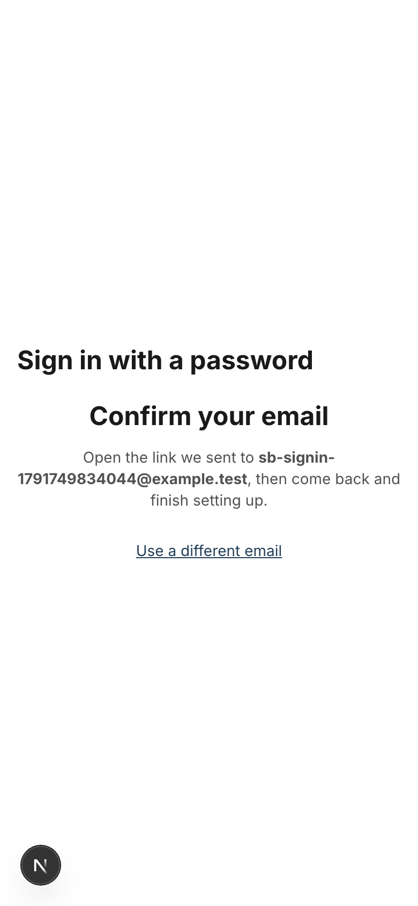

Copy on this screen:

> Confirm your email
> Open the link we sent to sb-signin-…@example.test, then come back and finish setting up.
> Use a different email

## 13. A returning email: "Welcome back", with the link under the password box

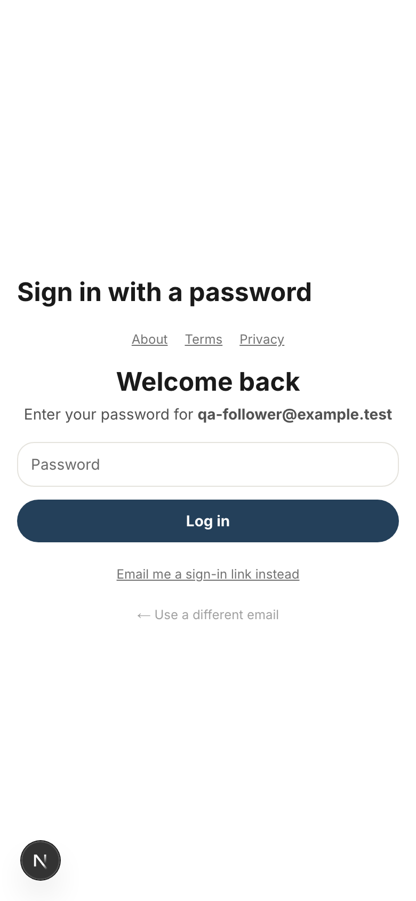

Copy on this screen:

> Welcome back
> Enter your password for qa-follower@example.test
> (placeholder: Password)
> Log in
> Email me a sign-in link instead
> ← Use a different email

## 14. Signed out on a Page, tapping "Sign up to follow": the sign-in prompt sheet (the frame the section 2 prompts render in; this one's wording is not in section 2)

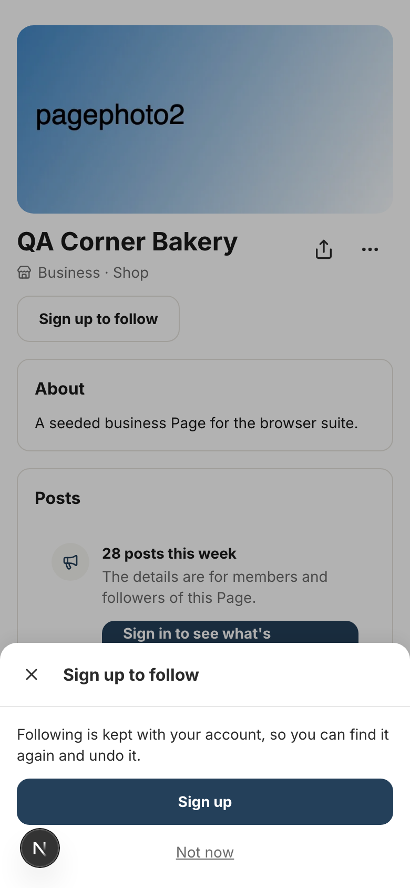

Copy on this screen:

> Sign up to follow
> Following is kept with your account, so you can find it again and undo it.
> Sign up
> Not now

## 15. Signed out on Explore, tapping "Map": the "Sign up to see the map" prompt

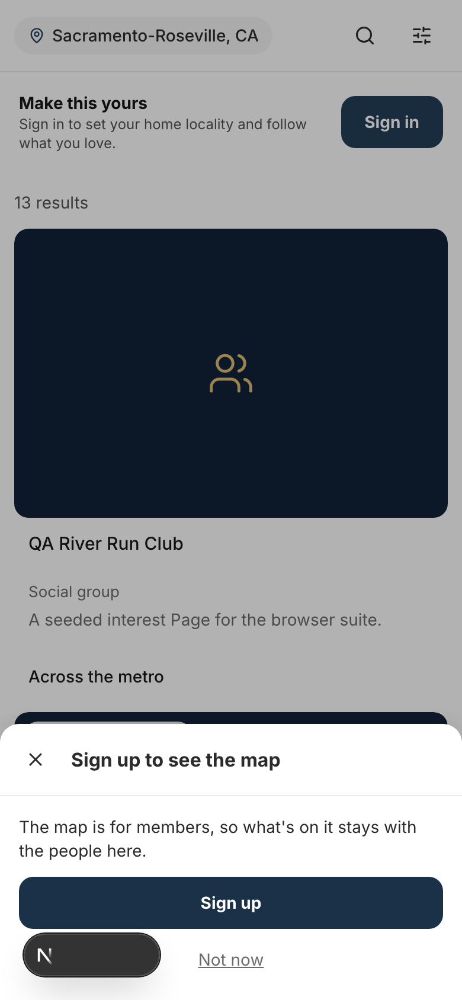

Copy on this screen:

> Sign up to see the map
> The map is for members, so what's on it stays with the people here.
> Sign up
> Not now

## 16. Signed out, tapping Report on a Page: it lands on the plain sign-in page, so the "Sign in to report this" prompt is not shown

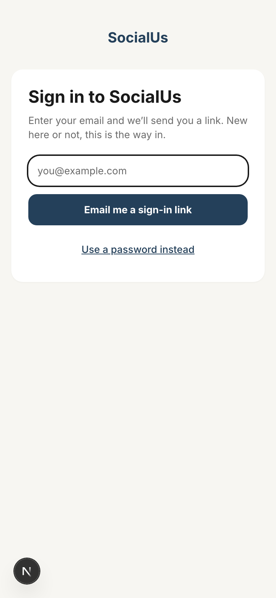

Copy on this screen:

> URL: /auth/login?next=/g/qa0b01?intent=report
> Sign in to SocialUs
> Enter your email and we'll send you a link. New here or not, this is the way in.
> Email me a sign-in link
> Use a password instead

## Old and new, line by line

| Where | Now (live) | Draft |
|---|---|---|
| "Check your email" (email-first) | We sent a sign-in link to {email}. Click it to finish — no password needed. | We sent a sign-in link to {email}. Tap it to finish. No password needed. |
| "Confirm your email" | We sent a confirmation link to {email}. Confirm it, then come back to finish setting up. | Open the link we sent to {email}, then come back and finish setting up. |
| Bad email (sign in and email-first) | Enter a valid email address. | That doesn't look like an email address. |
| Lookup failed (email-first) | Something went wrong. Try again. | That didn't go through. Mind trying again? |
| Password too short | Password must be at least 8 characters. | Passwords need at least 8 characters. |
| Email already has an account | You already have an account — enter your password. | Looks like you already have an account. Enter your password to sign in. |
| Button while working (both email-first buttons) | Working… | One sec… |
| Link under the password box | Sign in with a magic link instead | Email me a sign-in link instead |
| Gate modal, under "Sign in" (not on screen today) | We email you a link — no password, takes 30 seconds. | We'll email you a link. No password, and it only takes a minute. |
| Gate modal, business line (not on screen today) | Are you a business owner? Create a Page for your business → | Run a business? Start a Page for it. |
| "Sign in to get updates" prompt (not on screen today) | Updates arrive in the app, on your account — never in your inbox. | Updates show up in the app, not in your inbox. |
| "Sign up to see the map" prompt | The map is for members, so what is on it stays with the people here. | The map is for members, so what's on it stays with the people here. |
| "Sign in to report this" prompt (not on screen today) | An account lets us slow down someone reporting the same business over and over. It is not an identity check. | An account lets us slow down anyone reporting the same business over and over. It's not an identity check. |
