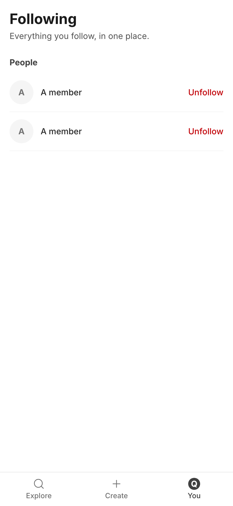
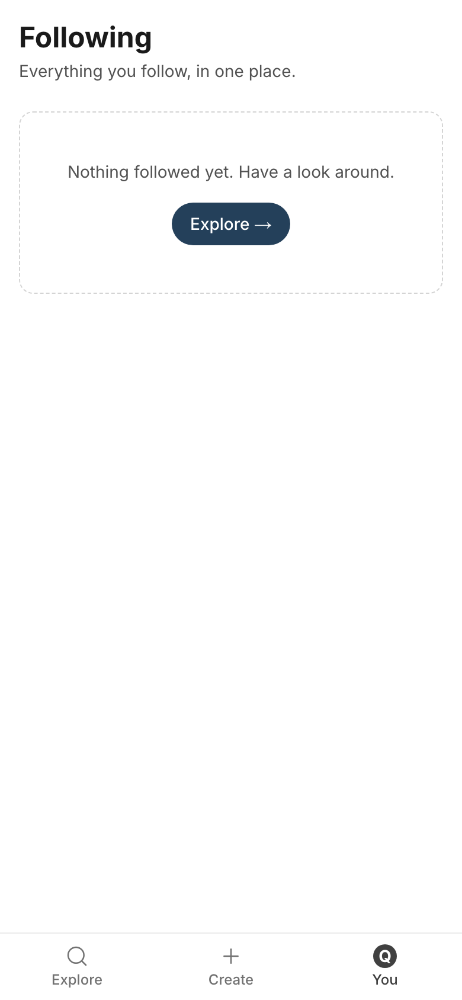
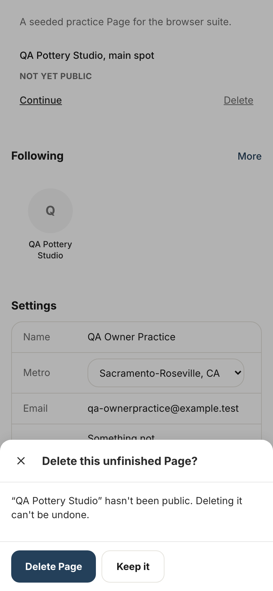

# Storyboard: You, Following and member screens (2026-10-11)

**Draft, not shipped.** Branch `copy/you-following-draft`, draft PR [socialus-web#689](https://github.com/donlafranchi/socialus-web/pull/689), not merged. Phone width (390px), local database with test members; names like "QA Pottery Studio" are test data. The dev "N" badge is hidden.

## Things you will notice (need your call)

1. **The report form's two labels are applied but cannot be seen.** 8.4 renames the pillars to "People who shop here" and "People who work here". The form that shows them (`ReportForm`) is not used by any screen today, so nothing is pictured. The labels also sit in the shared pillar list; if the form is retired, the change is harmless.
2. **The sign-in-first and "we couldn't open it" lines (8.7 to 8.14) are not pictured.** Each screen checks sign-in before it shows its controls, and the second family only appears if the address lookup fails right after a publish. Both are applied on the branch; neither can be reached on a normal run.
3. **The unfollow and follow failure line (8.2) and the metro "couldn't save" line (8.3) are not pictured.** They need a failed save; the metro line is covered by its test.
4. **The Following list uses showcase members** (shot 1), so names show as "A member". That is the seed data, not the copy.

## 1. Following, with people followed

> Following
> Everything you follow, in one place.

(The browser tab now reads "Following | SocialUs".)

## 2. Following, nothing followed yet

> Nothing followed yet. Have a look around.
> Explore →

## 3. Deleting an unfinished Page

> Delete this unfinished Page?
> "QA Pottery Studio" hasn't been public. Deleting it can't be undone.

## Not pictured, applied on the branch

- 8.2: "That didn't go through. Mind trying again?" on follow, unfollow and undo failures.
- 8.3: "Couldn't save that. Mind trying again?" under the Metro setting.
- 8.4: report pillars "People who shop here" / "People who work here".
- 8.7 to 8.10: "Sign in first, then try again." (start a Page, host a gathering, add a product, add a service).
- 8.11 to 8.14: "Your Page is up, but we couldn't open it just now. You'll find it under You." (same for gathering, product, service).
